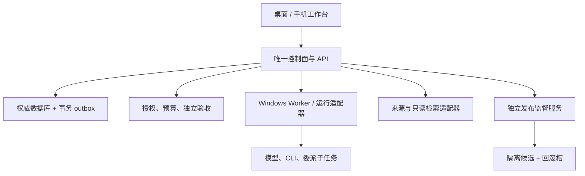
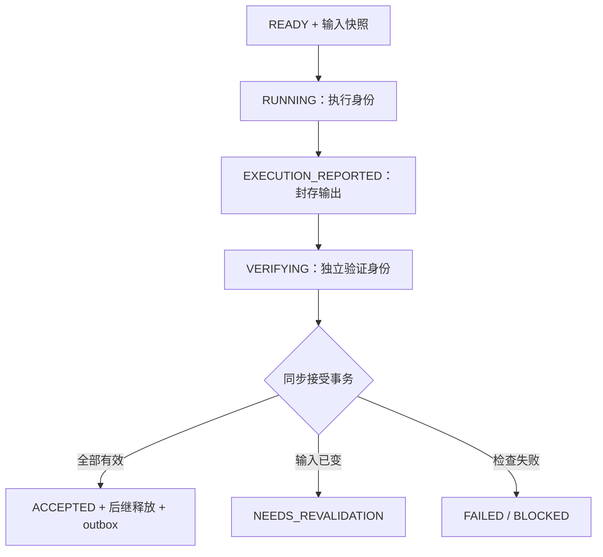

# 02 · 技术设计

版本：2.0；设计日期：2026-09-30；实现与产品测试：`NOT_RUN`。

本文给出实施约束及工程默认。数据字段和公开接口以 `03_DATA_CONTRACTS.md`、`04_API_CONTRACTS.md` 及 `contracts/` 为准；需求、任务、验收分别链接 `01_PRD.md`、`05_WBS.md`、`06_ACCEPTANCE_TESTS.md`。本包描述独立 ResearchOS，不继承 Quill Club 或 xiaoshuo 的身份、账号、目录或仓库。首个受管理项目是本包及后续新建的 ResearchOS 独立仓库；其他项目经显式导入后才可访问。

## 1. 架构不变量

1. **一个调度拥有者。** Goal、Task、Run 的归属、预算准入、依赖放行和最终接受均由选定控制面负责。运行器、研究工具、工作流和桌面宿主仅执行已委派范围。
2. **一个项目真值。** 数据库中的 ProjectState 与不可变产物是权威；Markdown、Agent 上下文文件、侧栏和消息摘要可重建，不单独改变有效需求。
3. **执行报告不等于接受。** 工具退出、模型回复、heartbeat 成功均只能提交结果。任务成为 `ACCEPTED` 前必须通过独立、服务器端、同步的验收门。
4. **版本随任务走。** 输入快照、rubric、模型、工具、代码、输出 hash 和接受回执相互绑定；旧结果无法因迟到而覆盖新决定。
5. **授权与判断分开。** Jev 提供用途合格的判断信号；权限、金额、日期、引用存在性及测试失败由代码处理，不能被模型高分豁免。
6. **稳定系统不由候选自批。** 自改在隔离工作区/进程运行；候选无权改自己的发布验收、凭据权限、稳定数据库或回滚入口。

## 2. 底座选型与冻结：W01 → W02

W01 先验证 Paperclip 固定基线 `v2026.916.1 / d554c4789ed3930f8a53ac9fdf6503b3187097da`。这是待验证候选，并非已获采用资格。实施者必须阅读该版本实际代码、SDK 与启动方式；本包 `/v1` 为 ResearchOS 接口，不声称是上游已有 API。

### 2.1 有限选型流程

1. 在独立资格工作区固定源代码及依赖，记录 OS、部署方式、适配器、数据库版本、登录方式与真实测试命令。
2. 尝试 A1：复用受保护的独立 verifier participant、现有策略与插件扩展，优先验证 Windows 原生前台控制面和执行适配器。
3. 若现有扩展不能形成同步验收门，尝试 A2：限定范围、可测试、可维护的核心修补。若原生控制面不满足要求，可在同一路线使用 WSL2/容器控制面 + Windows Worker；这不另开第二调度器。
4. A1、A2 各允许一次针对已观察失败的修复。每次记录方案、改动、测试与失败证据；不得改验收条件延长探索。两种整合方式上限耗尽、关键门失败，或证据不足以判断时，选择 Go 薄核路线。
5. 生成 `ADR-001` 和 `execution/route.json`，明确 `PAPERCLIP` 或 `THIN_CORE`、部署拓扑、固定依赖、资格证据及失败/回退理由。被选路线只有一个；另一条不进入 W02 产品骨架。

W01 通过指**路线决定有证据且只选一条**，不要求 Paperclip 必须成功。后续实现不得沿用旧蓝图的 Go 命令并同时建 Paperclip 核心。资格探索期间的测试数据库和原型都标注不可作为产品真值。

### 2.2 Paperclip 必须全部通过的门

| 门 | 必须证实的行为 | 不足以通过的证据 |
|---|---|---|
| 领取与派单 | 并发领取只产生一个有效归属；重复启动可对账；租约过期的执行者不能提交有效结果 | 顺序跑通一个任务 |
| 同步接受 | 执行者不能移除策略、自签回执或通过其他 API 直接放行；当前有效验收、最终状态和后继放行在服务端受同一个原子边界约束 | 完成后异步监听再改回状态 |
| Windows 生命周期 | 实际运行、日志续传、取消、进程树处理、重启对账、中文路径与宿主登录均有证据 | 只证明某个 CLI/ACPX 进程能启动 |
| 扩展持久化 | 域数据与上游 ID 一一映射；备份、恢复、迁移、权限与事件能满足本包合同 | 把核心表复制到另一份调度数据库 |
| 维护边界 | 修补有清单、回归及升级冲突检查；不依赖关闭授权检查或跳过验收 | 为跑通示例放宽生产身份权限 |

若选 Paperclip：上游 core 管 company/agent/goal/issue/checkout/heartbeat；ResearchOS 扩展保存 GoalContract、TaskContract、证据、实验、验收和 ProjectState。TaskContract 引用同一个 issue，不新增独立领取状态或派单循环。业务 Task 状态是受保护服务对 core 状态及域验收的统一映射，不是另一套可分别修改的账本。上游普通 `done` 不自动映射 `ACCEPTED`。

若选 Go 薄核：一个 Go 服务拥有身份、任务、调度、事务、事件与 `/v1`；React 提供工作台；SQLite 是单机权威数据库。采用成熟标准库/已锁定依赖，先实现单实例，不为潜在多租户或集群提前搭服务网格。模型与来源仍经相同适配器，避免路线差异泄露到研究合同。

## 3. 模块边界与进程

| 模块 | 输入/输出责任 | 禁止越界 |
|---|---|---|
| Project/Context | 导入、事实类型、版本、ContextBundle、影响关系与变更提案 | 摘要直接覆盖已接受事实；读取未导入项目 |
| Orchestration | Task DAG、唯一领取、调度窗口、Run 关联、后继释放 | 让模型输出直接执行任意状态 PATCH |
| Research | 来源窗口、去重、Candidate、核查、Experiment、采用建议 | 把热度当采用依据；把缺源写成空结果 |
| Evidence | 来源快照、定位、hash、传播关系、有效性和检索 | 把 SIMULATED/GENERATED 产物升级成 OBSERVED |
| Policy/Budget | 权限、资格、额度预留、外部动作准入 | 模型自行扩大权限或通过新子任务绕过限额 |
| Verification | 冻结规则、确定性检查、独立评审、接受回执 | 自签自验；用测试失败换高分放行 |
| Runtime adapters | 启动、事件、检查点、取消、恢复、费用与产物封存 | 自行派生不受登记的业务 Goal |
| Projection/Notification | 侧栏快照、事件流、MilestoneRelease 与应用内通知 | 保存另一份真实任务状态；普通 token 流伪装业务进度 |
| Evolution/Release | 候选、回归、canary、晋升与回滚 | 候选改监督服务、发布权限或自己的测试基线 |

首版默认进程：控制面一个、Windows Worker 一个、稳定 release supervisor 一个；React 构建静态资源由控制面提供。独立 verifier 可为受约束任务进程/服务身份，不要求新增常驻服务。Sirchmunk、n8n、Hermes 等仅在选用且资格通过后作为侧车；不得仅为“架构完整”启动所有调研产品。

### 3.1 目录和存储映射

以下是 W02 需要创建的目标结构，不代表第三方现有目录。W02 按选定上游结构生成 `execution/path_ownership.json`，将 WBS 的 `CORE / DOMAIN / ADAPTERS / UI / TESTS / OPS / EXECUTION` 映射到真实路径与唯一整合负责人，并生成经过实测的 `execution/commands.json`；WBS 后续只调用已登记命令。跨模块、锁文件、schema 与共享迁移由指定整合者提交，任务工作区不能抢写共享基线。

| 逻辑模块 | Go 薄核目标路径 | Paperclip 目标映射 |
|---|---|---|
| 控制面 | `apps/control/`、`internal/{domain,store,api,orchestration,policy}/` | 固定上游源码 + `extensions/researchos/`；核心修补登记于 `patches/paperclip/` |
| 工作台 | `apps/web/` | `extensions/researchos/ui/` 与上游受支持 UI 入口 |
| Worker/适配器 | `apps/worker/`、`adapters/` | 相同独立 Worker；`adapters/paperclip-worker/` 对接已核验的上游生命周期 |
| 监督/发布 | `apps/supervisor/`、`release/` | 相同职责；不能把此权限下放给普通插件任务 |
| 数据迁移 | `migrations/sqlite/` | `migrations/postgres/`；core 与扩展版本分别登记 |
| 验证/样例 | `tests/`、`fixtures/`、`contracts/` | 同一产品合同；上游测试另存证据 |
| 可变数据 | 配置指定 `data_dir` 下数据库、对象、journal、快照 | PostgreSQL + 配置指定对象目录；Worker journal 在 Windows 本地 |

每个新仓库的部署数据、缓存、密钥、日志与源代码分离。`project_id` 不能直接拼为任意宿主路径；路径通过服务端映射、规范化、项目根校验和符号链接/junction 检查取得。独立任务工作区禁止对稳定发布目录直接写入。

## 4. 持久化与事务模型

### 4.1 数据库默认

- **Go 路线：** SQLite WAL，启用外键与忙等待，写事务短小并统一进入服务端；事务提交使用可靠同步配置。数据库放本机固定盘，不放 SMB、云同步盘或不受支持的网络挂载。首版单控制面实例，以 OS 单实例锁和数据库一致性检查阻止双启动。
- **Paperclip 路线：** 使用该固定版支持的 PostgreSQL 与迁移机制；ResearchOS 域表处于独立受控 namespace，通过官方服务边界或经 W01 认可的窄补丁与 core 原子协作。不得假设普通插件 API 天然提供跨域事务，也不得随意直接改 core 表。无法获得必需原子性则资格失败。
- **Worker journal：** 本地 SQLite/追加日志保存 run↔进程树/工作区、事件序号、租约、未送回执与取消请求；是恢复记录，不拥有 Task READY 队列，也不能因控制面失联自行重派。
- **对象存储：** 本机内容寻址目录保存封存文件。先写临时对象、计算 hash、原子重命名，再于数据库事务登记 Artifact；崩溃后未引用对象可延迟清理。数据库回执不引用仍可被执行者覆盖的临时文件。

数据库保存实体与引用，较大原文/日志按对象引用保存。所有项目域查询强制携带 `project_id`；权限检查先于载入内容。可变聚合 `revision >= 1`，写入用 `If-Match`；已过期返回 412，合法版本但状态或幂等键冲突返回 409。金额使用十进制字符串与币种，不用二进制浮点。

### 4.2 Outbox、收件箱与投影

同一数据库事务提交业务变化与 outbox 事件。事件具有稳定 ID、聚合 revision、项目序号和关联 ID。序号只承诺项目流顺序；不得伪造跨项目全局因果序。

outbox dispatcher 采用至少一次投递。消费者收件箱以 `(consumer_id, event_id)` 唯一约束去重，业务效果与收件确认同事务落库。投影记录最后已处理序号；发现缺号先补取，不能让迟到旧事件覆盖新 revision。客户端断线重连若保留窗口已过，读取带水位的快照后接续增量，不能默默漏事件。

MilestoneRelease、对应 outbox 与业务接受在同一个提交路径中登记；通知按 `release_id + recipient + channel` 唯一。SSE/WebSocket 只运输状态，前端重放不得产生副作用。事件投影失败不回滚已经成功的权威事务，重放后应收敛。

### 4.3 调度领取、租约及 fencing

内部实现默认 `heartbeat_interval = 15s`、`lease_duration = 90s`，均为可配置运维值；跨设备以服务器租约为准，Worker 使用收到续租时的单调时钟计算本地失效时间，电脑从睡眠恢复须立即重新对账。

领取在一个短事务中校验 READY、依赖全部有效接受、授权和资源准入，绑定 owner/run，并递增单调 `lease_epoch`。PostgreSQL 使用行锁/条件更新；SQLite 使用串行写事务与条件更新，检查受影响行数。启动命令带任务、run、尝试号、epoch 与幂等键；Worker 先落 journal 再启动，并返回同一次启动的稳定标识。

所有 heartbeat、产物提交、报告、取消确认、费用结算都携带身份与当前 epoch。失效 epoch 不可改变任务当前结果；费用和已发生外部动作仍保存为迟到观察，用于对账。Worker 租约失效后停止新工具调用并尝试终止当前进程树；控制面在终止未确认时保留未决运行，不能仅因超时立刻重新执行有副作用的动作。

fencing 能阻止旧执行者提交，并不让外部邮件、模型请求或远端写操作天然恰好一次。支持供应商幂等键时复用；不支持且启动响应丢失时先查询/对账。无法判断是否已发生则阻塞该动作，保存 EffectReceipt 的未知状态，不盲目重发。

## 5. 执行、独立验收与依赖释放

1. 任务执行前冻结 ContextBundle、验收合同、实验条件、输入版本向量及授权。执行者可提出修改，不能修改本轮生效 gate。
2. Runtime 上报执行终态后，封存产物 manifest；`EXECUTION_REPORTED` 仅表示执行声明完整。中途输出可以查看，但不能成为正式当前成果。
3. 服务分派独立 VERIFIER 身份：程序重读文件、重算 hash、检查引用/范围/测试；需要定性判定时调用已通过相应用途资格的评审。作者无法取得自身接受权；独立性至少包含身份、输入、冻结规则及无改 gate 权限，不把“同一摘要换个模型再看”当完整独立验证。
4. 验证工作在事务外运行，避免长持锁。最终接受事务重新读取当前任务、运行归属、lease epoch、输入向量、rubric、产物 hash、必需结果、资格版本、授权及阻塞冲突。
5. 全部符合才写不可变 AcceptanceReceipt、原子迁移为 `ACCEPTED`、登记可运行的后继与 outbox。任一条件变化则拒绝该次接受；旧回执保留为历史，不支持人工/模型高分直接复活。

依赖判定读取有效接受，而非聊天完成语句、厂商 `done` 或缓存看板。已接受成果因上游变化而失效时记录原因，任务标 `NEEDS_REVALIDATION`，产物 validity 为 `STALE`；相应依赖不能继续放行。原始回执保持不可变，新验证产生新回执。

## 6. ContextBundle、冲突与并行协作

ProjectProfile 保存用户原话、已接受范围、事实来源、技术限制、未完成事项及历史采用/拒绝记录。事实区分 `USER_STATED`、`OBSERVED`、`ASSUMED`、`PROPOSED`，模型反复转述不改变其来源。

每次领取或恢复生成 ContextBundle：当前目标、必需决定、相关产物、未决冲突、允许路径/工具、验收合同、版本向量及摘要 hash。Agent 必须回显所用 bundle ID/hash；共享上下文文件包含来源 revision，修改只能形成 ChangeProposal。接受门的输入向量绑定本任务实际依赖的语义对象版本，不以任意聊天、进度投影或无关 Task 事件变化使全部运行失效；ProjectState 快照 revision 用于一致读取与发现变化，影响判定仍依据已登记依赖和政策。

并行写操作采用 revision 条件写入。冲突保留双方候选及基线，建立整合任务；禁止读取最新版本号后直接重试旧覆盖。独立 worktree/任务目录隔离文件修改；合并时校验基线、当前内容 hash 和受影响测试。

ChangeProposal 先求显式 ImpactLink 闭包，再由评审补充语义影响。提交时将接受的变更、关联版本、受影响对象的失效状态及事件原子登记；大型影响传播允许分批物化，但在传播完成前必须保留阻止受影响结果接受的失效屏障。不能宣称语义分析发现了所有自然语言冲突。未受影响任务继续。

AgentMessage 用稳定 message ID、project/task/run/correlation ID 和引用交流；去重不丢原始内容。嵌套 fanout 必须注册委派范围、子任务/子运行、预算和取消关系。外部框架内部细步骤可作为同一 Run 的子事件；凡形成独立项目成果或依赖的工作必须进入统一 Task 图。

## 7. 适配器合同及首版边界

### 7.1 RuntimeAdapter

能力包括配置验证、真实 probe、start、事件订阅/补取、inspect、checkpoint、cancel、reconcile。实现必须声明 `configured / probe_passed / live_execution_verified`、固定 backend/model/version、支持的取消/恢复语义、费用可见性和工具权限。不支持的能力显式报出，不伪造成功。

W05 至少完成一个真实已授权执行器；优先验证 Pi 的结构化运行协议，必要时用实际可用 CLI 适配器。Paperclip 选型与 Runtime 选型互不替代。Pi 的 `prompt success` 为接收，等待 `agent_settled` 后才提交稳定结果；取消执行顺序为 `clear_queue` → `abort` → 检查队列、当前工具子进程和会话 idle。持续 RPC 宿主可继续存在，不把宿主仍活着误判为任务没取消。

Worker 优先利用可验证的进程组/Windows Job Object 捕获后代、退出与资源；使用 taskkill 等回落实现时仍要验证子孙进程，不能只看父 PID。PID 必须结合启动时间、worker instance 与 job 身份，防止 PID 重用误杀。浏览器自动化/桌面操作仅作为明确能力范围内的适配器，不因没有 API 自动授予整机控制权限。

### 7.2 SourceAdapter

每个来源实现增量 discover、按规范化引用 fetch、来源健康探测、cursor 与失败分类。GitHub、X、论文是三类必需覆盖；实现可复用 last30days 单次 JSON 输出或合格原生后端，调度统一归控制面，不运行其独立 watchlist 总调度。

保存发现入口、原始 URL、canonical URL、发表/修改/抓取时间、未知日期、原文 hash、后端版本、输入项目 revision、来源覆盖与部分失败。空集、鉴权失败、限流、欠费、超时、协议不兼容分别记录。游标在该页结果与去重记录落库后推进；失败不推进成功游标。转载保留传播关系，不增加独立证据数。

X 内容可提供线索，关键技术结论回到代码、官方资料、原论文核查。日期按每条来源事实处理，不能因为工具名 last30days 就给一年论文贴“近30天”标签。抓取到的指令只是研究内容，不能改变系统规则或触发安装。

### 7.3 JudgmentAdapter

接口收取用途、有限题目/选项、经过核验的证据引用、rubric、模型固定版本与期限；输出原始模型信号、宿主判定、弃权原因及费用。Jev Choice/Score/Noul 的结果归一化由适配器完成；`ABSTAIN` 是宿主规则，不假称上游统一提供此字段。

资格键为 `task_type + language + provider + model_revision + rubric_revision`。从 SHADOW 到 ADVISORY、BOUNDED_AUTO 逐用途晋升；模型别名无法确定实际版本时不能悄悄继承资格。停机、缺源、矛盾或低置信时补证/回退规则/独立推理评审；不清空已接受状态，不一律把普通问题交回用户。正式阈值与样例要求见 A08；资格未过不阻断基础研究开发，但不能声称已拥有自动采用权。

### 7.4 LocalSearch / 技能 / 外部 I/O

基础检索用已授权数据库全文检索和 rg；Sirchmunk 为通过资格后的可选只读侧车。只接受 snapshot ID，由服务端映射到冻结目录；关闭无证据 LLM fallback，片段必须能映射到原文/hash/locator。缓存不是证据真值，源变更、删除或权限撤回后立即失效，具体资格见 A06。

book-to-skill 仅产候选 SkillVersion，期望输入 manifest 与成功/失败清单逐项对账；退出 0 不等于全部抽取成功。设计、营销和记忆技能按角色和任务加载，其上下文文件是 ProjectState 视图。MiroFish 后置，产物固定为 `SIMULATED`，不能加入真实事实投票。

外部工作流只执行一次有限 Invocation。ResearchOS 保存映射、幂等与回调；第三方 ACK 不算任务接受。未实际选择 n8n/Dify/Orca/Hermes 时不安装其依赖；需要时按固定版本的真实接口编写 adapter，不虚构产品命令。

## 8. 研究周期、费用与可靠性

每项目最多一个活动 ResearchCycle，初始每 6 小时、首次近 7 天；同类错过触发合并为一个待处理窗口。监控计划长期存在，周期和实验有独立完成条件。必需来源、核查、实验齐全并保存处置、回执、后续与游标才 `COMPLETE`；必需项缺失为 `PARTIAL`，无实质可推进为 `BLOCKED`。有证据的 REJECT/WATCH 允许完成，不强制采用。

初始全局并发 2、队列 100；不由上游默认预算覆盖用户的 `UNLIMITED_AMOUNT`。同输入同错误最多重试 2 次；连续 3 轮无新有效证据或预注册指标改善，转 `DEFERRED_NO_PROGRESS`。计数键绑定原问题、候选及输入 hash，子 Goal 不重置。

预算模块先解析所有生效作用域及周期，执行最严格约束；严格 CAPPED 在一个事务预留可靠上界并发额度。无可靠费用上界则该调用阻塞或等待用户明确选择其他预算模式，不能显示硬限额已经保证。默认金额不限可在已有授权下执行未知费用调用，但记为未知；不产生零成本推断。实际结算、预留释放与迟到账单都可追踪，见运维文件。

## 9. 权限、凭据与设备

角色为 OWNER、PLANNER、EXECUTOR、VERIFIER、SCHEDULER、RELEASE_SERVICE、SOURCE_ADAPTER、READER，具体动作权限以 API 合同为准。服务 token 限 project/task/run、有效期和能力；执行者不能改验收、预算父上限、发布身份或密钥存储。业务授权可长期生效，常规已授权、可逆动作自动推进；只有真正超出范围的动作产生具体请求。

密钥存放系统凭据库或经实测的加密凭据后端，数据库只保存引用；不写进 ContextBundle、命令参数、报告、源文件或备份明文。Worker 按调用短时取得必要凭据，在受限进程环境注入；日志进行结构化脱敏并测试错误路径。外部文本、技能和插件代码不被当作授权主体。

Windows 隔离默认采用独立非管理员执行身份、任务目录 ACL、独立运行器配置/登录 profile、只读输入快照、可写候选目录及受控出口。执行进程不能读取 Owner 个人 profile、其他项目、稳定发行目录、凭据库或数据库文件。Job Object 只用于进程生命周期与资源控制，不构成文件/网络沙箱；仅设置 cwd 或在提示词写“不要越界”也不算隔离。网络权限由经验证的宿主防火墙/受控出口强制执行，不能只依赖 Agent 选择工具。具体机制、Windows 版本及继承权限在 W02/W17 固定，并用读取其他项目、直连未授权地址、访问稳定密钥等反向用例验证；无法约束的运行器只能在明确受信的开发资格环境运行，不能宣称通过生产执行隔离。需要 GUI 登录的适配器另登记能力，不把它的交互桌面权限扩散到所有任务。

supervisor、凭据代理与普通执行器使用不同 OS 身份/受保护路径，候选不得改服务配置或稳定门基线。服务进程重启不放宽 ACL、出口或 token scope；身份无法恢复时阻塞相应任务并保留只读监督。

本地 UI 初始仅监听 loopback。手机监督使用经资格测试的 TLS 入口/隧道；默认不直接暴露 Worker、数据库、Sirchmunk 或上游无鉴权端口。配对在已登录桌面发起，一次性随机令牌、短时过期、一次使用，手机获得可撤销设备身份。查看为默认能力；暂停/恢复/取消/配置修改须显式受设备能力及当前用户授权控制。认证、CSRF/Origin、重连、丢失撤销与日志脱敏见 A11。

## 10. 交付边界与未证实项

W02 必须把 OS、编译器、数据库、Node/Python 等选定版本与依赖锁定，并生成可重复的实际命令映射；本包没有声称任何尚未创建的命令已经可运行。当前 Windows 原生/WSL 方案、生产账号来源、Jev 资格、UI、恢复、自改发布和隔夜行为均为 `NOT_RUN`。

先完成 A02/A03/A04 的控制与合同，再接实时来源、实验、Jev 和界面；A13/A14/A16 的端到端、隔夜及独立回滚是发布必需依赖。缺少某项实时资源可继续独立 fixture 开发，但必须保留该 live gate 阻塞，不把样例数据重新标为真实业务验证。操作恢复、升级和自动演化的执行约束见 `07_OPERATIONS_AND_EVOLUTION.md`。

## 11. v2.0工作台、评测与受限产物

工作台使用现有UI进程/路由与ResearchOS API；以contracts/ui.contract.json对接operationId和字段，ui/design-tokens.json作为主题单一来源。服务器的ProgressProjection、EventEnvelope、MilestoneRelease驱动进度与通知；前端不得持有第二份可独立写入的Task状态。详情/高级过程经Run、correlation和Artifact关联，借鉴PentAGI而不依赖整套平台。

EvaluationAdapter运行于受限Worker/Verifier作业中，复用Experiment与Run生命周期。Promptfoo的外部evalId只是映射；归一化报告通过Artifact封存，不新增评测业务调度器。具体输入输出、统计和失败出口见11_EVALUATION_AND_INTEGRATION.md。

Artifact新增access_class：PROJECT仍受项目范围约束；VERIFIER_ONLY由受保护身份和存储强制执行，普通候选/Executor/Planner不能读取。正式留出输入、标签、逐例输出及详细日志必须受限；公开汇总由独立服务生成不泄题内容。既要限制API、搜索、事件、预览和导出，也要通过OS身份/ACL或容器限制候选直接读文件，不能只在UI隐藏按钮。

已封存产物不可直接编辑。预览读固定id/revision/hash；草稿编辑产生ChangeProposal。冲突保留双方与旧基线，不先更新版本号再提交旧内容覆盖。HTML无脚本隔离；超限分块/下载，具体阈值见10。

本版不增加常驻Graphiti、PentAGI攻击工具或整套监控平台；仅在可测缺口出现后以新候选实验决定。源项目的完成状态和Docker权限不直接成为本产品的验收/沙箱边界。
