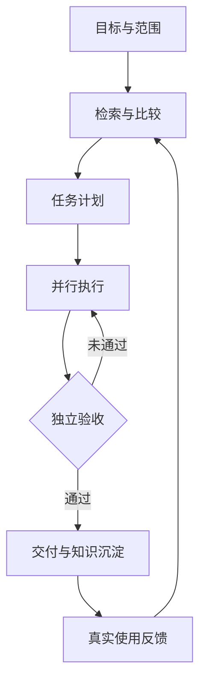
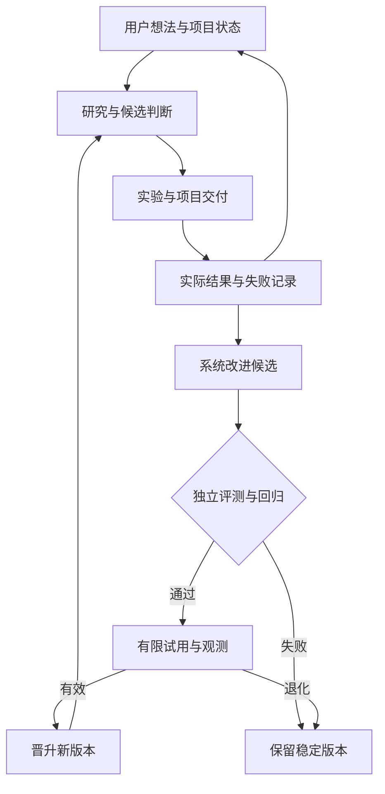

# ResearchOS：设计思路、目标与组件接入汇总 v1.1（需求澄清修订）

实施交接更新：2026-09-29 已将本稿第 13–16 章及此前有效设计收敛到 **ResearchOS_Implementation_Package_v1.0**。后续实施以该包的 00_START_HERE.md、PRD、技术设计、数据/API合同、WBS、验收及运维文件为唯一执行基线；本稿保留为调研依据。下文“尚未形成最终实施包”等表述是各轮当时状态，不再作为阻止开始 W00/W01 的理由。规格包完成不代表产品已开发或通过实机验收；底座仍由包内有界资格任务确定。主稿 v6 的原始内容已作为规格包来源快照封存。

日期：2026-09-29（Asia/Shanghai）  
状态：设计与源码调研完成本轮增量；未安装、未开发产品、未完成 Windows 实机资格验证。  
累计纳入：28 个用户提供的不同仓库，另有 Open WebUI Computer，共 29 项。第 15 章保留上一批六仓调研；第 16 章新增本批十二仓核验（Sirchmunk 复核、11 项新增），覆盖情报发现、资料转技能、执行与记忆、设计增长及模拟。纳入调研不等于安装或选定依赖。

需求修订：2026-09-29（Asia/Shanghai）用户明确首要场景、自主迭代目标，并补齐第 5 题的费用、等待及汇报要求；本次统一落实到第 13 章。文件名与原文件身份保留，避免再增加一份并行主稿。第 13 章区分用户已明确的目标、设计建议与待实测项。

## 0. 这份文件的效力

这是独立新项目 ResearchOS 的当前设计汇总，不继承 Quill Club 小说项目的工作区、连接器、仓库或部署。Codex 指正在与用户协作的 AI；本阶段任务是把设计和调研做清楚。

依据已读取的三份当前文件：
1. ResearchOS_Implementation_Blueprint_v1.0.md；
2. ResearchOS_Six_GitHub_Projects_Review_v1.0.md；
3. ResearchOS_Agent_Office_Review_v1.0.md。

本版明确修订旧蓝图的一个决定：**重开组织/调度底座选型，优先验证 Paperclip 扩展路线。** 旧文“无须再开放架构选择”不能继续作为跳过该核验的依据。用户目标与验收要求保留；Go/React/SQLite 全部自建不再视为不可调整的前提。

本文件不是旧蓝图全部接口的替换稿。通过 CORE-01 后，必须把选定路线合并成唯一实施蓝图，再让 AI 执行完整产品 Goal；不能一边照旧版建 Go 调度器，一边照本版再建 Paperclip 调度器。

**当前效力：**第 13 章覆盖旧蓝图及本稿中与“首要场景、Jev 永久仅旁路、所有定性评价必须用户逐次验收、自身迭代范围、默认金额上限、运行时长和成果汇报”冲突的旧设计。其余合同继续保留。架构、机器可读合同与 WBS 尚未同步完成，当前文件仍是设计收敛稿，不能标为最终实施包。

同时区分两个概念：
- **用 Codex Goal 模式建设本项目**：把设计变成依赖清楚、有产物与验收条件的实施任务。
- **ResearchOS 内部的 Goal**：产品自身保存和执行的业务目标；不假设任何厂商都有一个名叫 Goal 的公开 API。

## 1. 我们到底要做什么

**让用户提出想法，系统持续维护项目上下文，组织 AI 查资料、比较现成方案、开展实验与开发、验证产物，并依据真实结果改进自身工作方法和所管理项目。首要落地场景是持续跟踪 GitHub、X 和论文，发现对项目有用的东西，并验证是否值得采用。**

产品定位：个人 AI 研究与执行工作台。它组织真实可调用的模型、CLI、协议工具和工作流，把研究、工程执行与结果验证连起来。

### 1.1 用户应得到的结果

| 用户需求 | 产品必须做到 |
|---|---|
| 提一个目标就能推进 | 形成可编辑计划，拆分任务与依赖，确定产物、预算和验收条件 |
| 少操心重复小事 | 已有授权内自动查资料、调用工具、分派任务、有限修复与重试 |
| 多个 Agent 能互相协作 | 委派、评审、求助与交接都有真实任务和证据记录 |
| 尽量复用现成成果 | 先查本地资料、已有依赖，再查 GitHub/官方文档/候选工具 |
| 知道究竟做成了什么 | 每个结论能回到来源，每个交付能回到产物与验收回执 |
| 手机也能监督 | 查看进展、阻塞、费用和回执，执行已授权的有限控制 |
| 下次不用从头开始 | 保存采纳理由、失败经验、技能版本、实验结果及后续反馈 |

首版用户默认一个 Founder；电脑承担执行，手机承担监督。多人云服务、商业多租户、公开插件市场和原生手机 App 不进入首版。

### 1.2 哪些事情由谁负责

- Founder：定目标、优先级、可接受成本和权限范围；处理确实超出既有授权的事项与需要人的业务判断。
- 规划 Agent：检索已有知识与工具，提出计划、候选方案、反例和小实验。
- 执行 Agent：领取范围明确的任务，使用对应工具，提交产物与运行记录。
- 独立验证器/评审者：依据固定规则检查结果；执行者不能仅靠“完成了”把自己验收通过。
- 主系统：维护身份、任务归属、授权、成本口径、状态、回执与恢复规则。

模型和产品品牌是可配置运行时，不是永久职务。六类职责保留：产品/业务、算法/数据、工程/平台、设计/体验、测试/评估、运营/增长；没有可用能力的角色显示未分配。

## 2. 主工作流程

1. **定义目标**：说明问题、预期产物、验收条件、允许使用的目录/服务和预算。
2. **查已有成果**：搜索本地研究卡、文档、代码、技能；再查目录、GitHub、官方文档等外部证据。
3. **比较与验证**：把候选变成可核查的假设，记录许可、兼容性、成本、反证和采用条件。
4. **形成计划**：拆成 Task，明确依赖、执行实例、输入、输出、失败出口与验证器。
5. **并行执行**：在并发与授权范围内自动调用 Agent/工具；需要帮手时提交协作请求。
6. **独立验收**：检查引用、代码、测试、文件和实际行为；失败时有限返工，仍失败则给出明确阻塞。
7. **交付与复用**：保存产物、证据、采用决策、技能/配置版本。
8. **反馈改进**：记录真实采用效果和失败反例，更新检索、路由与工作方法。



“改进”首先指可追溯的知识、技能、模板、策略及系统代码更新，不承诺自动训练模型或未经测量的能力提升。决策层是核心能力，Jev 是其中的候选判断组件；先校准，再在通过资格的有限范围内自动决策。它不单独授予权限或把任务标为最终验收通过，详见第 13 章。

## 3. 所有已调研项目的角色

以下是本项目的分工选择，不是断言这些产品只能做这一件事。没有要求把整张表全部安装。

| 层 | 项目 | 设计位置 | 首版处理 |
|---|---|---|---|
| 候选资源发现 | Awesome | 主题清单与成熟方案线索 | 共用 CatalogScout，按主题启用 |
| 候选接口发现 | Public APIs | API/MCP 候选目录 | 优先做结构化小样导入，二次官方核验 |
| 成本与服务备选 | Free for Dev | 免费层与基础设施比较 | 保存核验日期、额度与限制 |
| 网页内容获取 | Scrapling | 已知 URL 的正文与动态页取证 | 可选采集组件；不冒充全网搜索 |
| 本地检索增强 | **Sirchmunk** | 搜文档、代码、证据快照 | 优先做有限 PoC；基础检索可独立工作 |
| 团队组织与调度 | **Paperclip** | 优先资格验证的底座候选 | 验收/Windows/恢复门通过后才正式选用 |
| 外部服务自动化 | **n8n** | Webhook、外部连接器、数据流转 | 可选外部实例；第一批只读流程 |
| LLM 研究流程 | Dify | 提取、检索、分析、报告的内部工作流 | 有明确节省时采用；不与 n8n 重复建设 |
| 对话入口 | Open WebUI | 多模型问答和窄工具面 | 可选；不替换正式任务与验收真值 |
| 本机工作台候选 | Open WebUI Computer | 文件/终端/编码代理/手机界面参考或底座候选 | 独立许可及执行边界核验，不默认叠加 |
| 团队展示 | Agent Office | 任务板、活动流、可选办公室表现 | 画面只投影真实事件，不沿用模拟评分 |
| Jev 工作流与技能 | **wuyoscar/jev-skill** | 判断模板、任务检查点、证据核查、成果评审、受限动作选择 | 本轮补入；固定源码审查与用途验证后按需复用，未安装/接入 |
| 提示词与技能候选 | f/prompts.chat | 按任务能力缺口查找模板/技能，生成可评测候选 | 先只读导入；无需首版部署整套站点 |
| Jev生态发现与分类 | yibie/awesome-jev | 增量线索与基于证据的分类/弃权方法 | 优先接入候选发现；代码复制前核实完整许可 |
| 截图定位/界面动作 | Tongyi-MAI/MAI-UI | 可选GUI定位和移动导航，持续跟踪Qwen-UI-Agent后继 | 等执行器和平台资格；不阻塞首版研究 |
| 本地判断模型 | Yinsongxu/LLM2Jev | 独立本地DecisionProvider，供隐私/离线/分流对照 | 先shadow并独立校准；不冒充官方Jev |
| 历史会话/异常升级参考 | humanlayer/humanlayer | 参考旧会话生命周期与异常升级接口 | README声明代码基本弃用；不新增首版依赖 |
| Windows执行与监督候选 | stablyai/orca | CLI会话、worktree、结构化派单与移动监督 | 与已有执行候选同任务对照；保留独立验收 |
| 近期研究发现 | **mvanhorn/last30days-skill** | GitHub/X/arXiv 候选、来源状态和变化发现 | 优先验证单次 JSON 调用；ResearchOS 统一调度 |
| 来源能力登记 | Panniantong/Agent-Reach | 来源后端选择、配置与健康诊断参考 | 按渠道选用；MCP 状态不当作搜索完成 |
| 资料转候选技能 | **virgiliojr94/book-to-skill** | 已核验资料抽取、知识结构与候选技能生成 | 优先小样验证；来源覆盖与版本晋升由主系统负责 |
| 汇报呈现参考 | ayghri/i-have-adhd | 可选简洁汇报、阶段提示与可展开证据 | REFERENCE；不作为记忆或可靠性组件 |
| 设计知识检索 | nextlevelbuilder/ui-ux-pro-max-skill | 设计系统候选、技术栈与组件指南 | 按设计任务启用；保留现有设计版本 |
| 界面质量 | pbakaus/impeccable | 工作台/报告审查、确定性检测、精修 | 优先界面小样；检测引擎/hooks 单独验证 |
| 执行与模型接口 | **earendil-works/pi** | JSONL RPC/SDK、会话与 Jev 分类接口 | 优先执行资格；完成事件仍需独立验收 |
| 记忆与协作方法 | **rlaope/oh-my-hermes** | 记忆准入、交接证据、隔离派单与验证门 | 先吸收合同；整体插件作为可选子任务执行器 |
| 业务增长技能 | coreyhaines31/marketingskills | 产品背景、客户研究、定位、实验与发布方法 | 首期只读研究/草稿；API 写动作单独登记 |
| 场景模拟 | 666ghj/MiroFish | 模拟用户反应、假设与反例探索 | 后置可选实验；模拟产物不得计为现实证据 |
| DSH 体验插件参考 | lyhue1991/dsh-soup | 文件侧栏、成果预览、Goal 展示 | REFERENCE；修改冲突保存规则并核验宿主后再考虑接入 |

首版最小闭环应能在没有 Dify、n8n、Sirchmunk、办公室动画时完成。组件失效不得导致基础任务账本和已有产物不可用。

### 3.1 项目纳入核对与 jev-skill 的具体位置

2026-09-29 核对：用户此前依次提供的 Awesome、Public APIs、Scrapling、Free for Dev、Open WebUI、Dify、Agent Office、Sirchmunk、Paperclip、n8n 共 10 个项目，均已列在第 3 章。Open WebUI Computer 是额外调研候选。上一个版本已有第 13.4 章的 Jev 决策设计，但没有单列 `wuyoscar/jev-skill` 仓库；本次补齐这项遗漏。

**状态口径：**列入设计只表示已定义用途及采用条件。上述组件均不能据此标为已安装、已集成或已通过 ResearchOS 实测；首版也不要求全部装上。正式实施包须逐项登记 `REFERENCE / CANDIDATE / QUALIFIED / INTEGRATED` 及证据。目前 jev-skill 为 CANDIDATE。第 3 章是本稿纳入清单，最终依赖锁定与 Goal 映射仍由第 10–11 章的实施收敛完成。

第 15 章所对应的一轮增加 6 个仓库，当时用户提供项目累计 17 个，加上 Open WebUI Computer 为 18 项。第 16 章本轮收到 12 个链接，其中 Sirchmunk 已有，新增 11 个；当前为 28 个用户提供的不同仓库，加上 Open WebUI Computer，共 29 项。此计数只覆盖第 3 章组件清单，不把更早的外围方法参考算作已集成项目。HumanLayer、i-have-adhd、dsh-soup 为 REFERENCE；其他新增项为 CANDIDATE。Sirchmunk 只更新核验记录，不重复建组件；所有本轮项目均未达到 QUALIFIED 或 INTEGRATED。

**仓库观察。** 当前 main 核验基线为 `b7593a624a1b452769b554e0a688786089bd4bd7`，提交时间 2026-09-28T11:51:59Z。仓库是社区工作流、技能与示例集合，不是 TypeSafe 官方 Jev 模型，也不是完整调度服务。源码预览为 5 个技能入口；README 明确已发布 v0.2.0 仍为 11 个入口，二者不得混用名称和安装结构。仓库自有内容采用 MIT；被其目录链接的其他项目须分别核验。[K1][K2]

| 技能入口 | ResearchOS 中的落点 | 具体复用内容 |
|---|---|---|
| jev | 决策适配器与任务检查点 | 把目标拆成有限问题；批量判断；检查任务偏离、重复失败、工具/模型路由和完成证据 |
| jev-triage | 持续研究的候选初筛 | 对 GitHub、X、论文候选分类、排序，保留无法判断项；筛选不等于事实核验 |
| jev-documents | 主张与来源核查 | 文档/代码证据定位、主张与证据关系判断；来源访问与引用存在性由宿主检查 |
| jev-eval | 研究、代码与实验产物评审 | 依据固定标准评价实际产物、差异和测试回执；评审线索进入 DecisionReceipt |
| jev-act | 已有工具的下一步动作选择 | 从宿主给出的合法候选中选择下一步；点击、命令、发送与验证仍由相应工具完成 |

其中 `jev/references/checkpoints.md`、`jev/assets/checkpoint.json`、`jev/assets/completion.json` 对应 C07/C16；`jev/references/context.md`、`jev/assets/context.json` 对应 C01/C03；`jev-eval` 的完成证据检查与计划/实际对照对应 C07/C20。把这些作为模板来源，替换为当前任务的真实目标、约束、原始证据、版本和可选动作，不直接把示例内容当生产判据。[K3][K4][K5]

**上下文处理。** 优先复用其“原始内容可取回、保留来源 ID/错误/未完成任务/用户约束、不确定内容不隐藏”的方法。Jev 可以建议相关性和压缩时机，不能代替 ProjectState、ContextBundle 或决定哪份文件具有最终效力。其上下文工作流先以 advisory 验证，不直接修改历史会话或永久删除证据。[K4]

**适配边界。** 先复用问题、模板和工作方法，不直接把全部技能安装为强制调用链。ResearchOS 以第 13.4 章统一 JudgmentAdapter/DecisionReceipt 消费判断；可选 `jev-decide` CLI 是传输路径，不另建调度器。CLI 需要 Python 3.10+；服务路线显式指定 TypeSafe 或 OpenRouter，不能依赖默认供应商，也不能在出错后静默切换为模拟。基础证据检索与状态读取仍可独立运行。[K2][K5]

**必须检查的输出语义。** `--dry-run` 仅检查输入格式；真实 decide 调用的退出 0 表示得到选择/评分，不代表业务验收通过；dry-run/setup 成功也会退出 0。低 Score、确定的 Noul=false 都可能是合法返回；宿主必须解析每个 answer、缺失证据、用途资格和当前规则。CLI 的 Choice 默认门槛作用于最高概率与分差，不是 API confidence；Score 不会因低分或低置信度自动转待评审。领域门槛由 ResearchOS 的用途资格决定，不直接照搬包装器默认值。退出 2 保留待评审，退出 1 为调用/协议错误。模拟模式必须保留 `jev_called=false`、实际模拟模型和空概率/置信度，不得计入真实 Jev 验收记录。[K5][K6]

**纳入动作。** 本轮只完成源码/设计映射。JEV-SKILL-01 固定来源并完成离线合同测试；JEV-SKILL-02 用真实中文和中英样例完成用途资格。复用或安装时记录源码版本、许可、被改动的模板及上游差异；升级作为变更提案重验，不跟随 main 自动覆盖稳定规则。首版优先使用检查点、候选初筛、证据核查、成果评审，动作选择留待宿主工具能力通过验收。

作者的五入口验证记录包含 OpenRouter 真实 smoke 调用，但其 TypeSafe 原生接口记录仍为离线验证；不能转写为 ResearchOS 已验证。其小型对照实验也显示固定频率加检查点未必提升任务成绩。因此研究设计以存在歧义、重复失败或完成声明等事件触发，不要求每个普通步骤都调用 Jev；使用固定样例比较带/不带判断层的实际效果。[K7]

## 4. 三个新增项目的核验快照

| 项目 | 固定核验版本 | 许可与技术观察 |
|---|---|---|
| Sirchmunk | v0.2.0，2026-09-20；bf754a4598f72df0d4279aa0c5c4b795c1c43a0c | Apache-2.0；Python 3.10+，rg/rga、LLM、DuckDB 等依赖 |
| Paperclip | v2026.916.1；d554c4789ed3930f8a53ac9fdf6503b3187097da | MIT；Node/React/PostgreSQL；插件和外部 adapter 扩展 |
| n8n | n8n@2.41.3，2026-09-25；7f7a8ac25b87db6c30e2b3651bb8c5d3b21cdb85 | Sustainable Use License，企业文件另有许可；Node 服务，可 Docker 部署 |

三者均未归档。Paperclip master 与稳定版不等同；n8n 当日 2.42.0 是预发布，未选作基线。版本、文档声明和源码观察不等于本机实测结果。

本表保存第一次核验基线。Sirchmunk 的本轮复核版本与两端源码差异见 16.2；旧检索设计及未完成的资格要求继续有效。

## 5. Sirchmunk：加入本地知识检索层

### 5.1 对我们的帮助

当资料量增长后，仅靠关键词搜索容易漏掉跨文件的相关证据。Sirchmunk 直接探索原始文档和代码，适合“先看看以前研究过什么”“找某接口定义与调用位置”“从 PDF 和报告中找支持/反对证据”。

它的 index-free 指不必先建向量/分块索引即可搜索，不意味着没有初始化、存储、模型调用或缓存。它会检查/尝试安装 rg/rga，初始化还可能下载 embedding 模型；知识 cluster 可存 DuckDB/Parquet，并使用 embedding 复用；compile 是可选 Beta 预处理。不能把这一描述写成“零依赖、零成本、永不失效”。[S1–S4]

### 5.2 接入合同

定义可替换的 LocalSearchAdapter，首版保留数据库全文检索/rg 后备。Sirchmunk 独立服务只接收主系统解析的只读快照路径；手机、模型工具和外部工作流只提交 snapshotId，不提交任意宿主路径。

```ts
type LocalSearchRequest = {
  projectId: string; requestId: string;
  snapshotId: string; query: string;
  mode: 'FAST' | 'DEEP';
  topK: number; maxTokens: number; deadlineMs: number;
};
type LocalSearchResult = {
  searchRunId: string;
  answerDraft: string | null;
  hits: Array<{
    sourceId: string; artifactId: string;
    quote: string; locator: string | null;
    contentSha256: string; originalUrl: string | null;
  }>;
  usage: { tokens: number | null; costStatus: 'known'|'estimated'|'unknown' };
  warnings: string[];
};
```

- 真实入口：POST /api/v1/search、POST /api/v1/search/stream；GET /api/v1/search/status 是服务健康/配置检查，不能假装是任意 SearchRun 查询接口。
- 使用 response_format=context，提取 answer、cluster.evidences、retrieval_logs 与 total_llm_tokens；关闭 llm_fallback，避免没找到资料却用模型记忆冒充检索答案。
- evidence 可有 file_or_url、doc_id、snippets 与 page_range，但页码等字段可能缺失；适配器须验证片段存在于冻结文件、计算 hash 并映射 sourceId。
- 数据库里的研究卡不会自动变成可搜索文件；先导出 Markdown/JSON 快照与 sourceId 映射表。当前部署使用哪种数据库不改变该合同。
- cluster 只做检索加速缓存；新文件版本不得沿用旧引用。当 hash 变化、文件删除或授权收回时，旧命中失效。
- 第一批查询先基础检索，确需语义跨文件探索时才用 Sirchmunk FAST；DEEP 由任务范围和预算决定。mode、版本、耗时、token 和错误均记录。
- MCP 源码实际注册 sirchmunk_search；文档列出的 get_cluster/list_clusters 在该版未注册为工具，不能写进依赖清单。[S2–S5]

### 5.3 采用前必须解决的边界

固定版 /api/v1/search 没有调用 chat 路由使用的严格路径白名单校验；仅设置 SIRCHMUNK_ALLOWED_PATHS 不足以保证搜索入口受限。ResearchOS 入口必须校验非空路径映射、规范化结果和符号链接；侧车不直接暴露给手机或模型。优先仅挂载授权的只读快照及必要独立缓存目录，不能把整个用户目录交给它。鉴权、网络隔离与缓存写目录由我们的部署合同实现和验证。[S2][S6]

Python/格式转换依赖不应隐式装进基础发行包；依赖安装放在明确的插件初始化步骤，固定版本和来源。Windows 曾有兼容修复声明，本轮未获得 Windows 实测证据；文字 PDF 与扫描 PDF/OCR 能力也要分别验证。超时或断连不能宣称所有模型/子进程都已取消；无法确认时记录未决费用并核查。

## 6. Paperclip：重开底座选型，优先验证复用路线

### 6.1 为什么需要修正旧判断

当前稳定版已有组织与目标、issue、原子领取、heartbeat、持久 session、预算、评审流程、worktree、插件与 adapter。源码中的 checkout 使用带期望状态和运行归属条件的数据库更新，冲突返回409；内建 executionPolicy 会把执行者的完成请求转入 review/approval 阶段。它与我们的需求重叠很大，不能只因为使用 PostgreSQL 就排除。[P1–P4]

**本版优先验证路线 A：Paperclip 作为唯一组织/任务调度核心，ResearchOS 提供研究证据、实验和确定性验收扩展。** 原 Go 独立薄核心成为路线 B 的回退方案；不同时运行两套派单器。

### 6.2 路线 A 的职责分配

| 能力/数据 | 负责方 | 明确边界 |
|---|---|---|
| company、agent、goal、issue、领取与 heartbeat | Paperclip | 唯一任务归属及调度权；不用 Go 再派一遍 |
| 业务 Goal 的验收合同与最终结果 | ResearchOS 插件，关联同一个 Paperclip goalId | Paperclip Goal 是层级目标对象；产品的成功条件需另存扩展字段，不能直接将原对象状态视为完整 Goal 状态机 |
| 来源、Observation、Claim、研究卡、实验 | ResearchOS 受信插件 | 自有数据库命名空间，引用 Paperclip 的 ID |
| Acceptance、EffectReceipt、具体授权范围 | ResearchOS 验证/动作服务 | 与当前 issue/run/产物 hash 绑定；不能用普通评论替代 |
| Windows 本机进程、worktree、日志、取消 | 先验证原生 adapter；必要时 Windows Worker + 外部 adapter | 只执行合法 run，不自行决定业务任务或自动重派 |
| Sirchmunk/Scrapling/n8n/Dify 调用 | 有类型合同的 adapter | 外部执行成功只算待验收结果 |
| 展示、手机监督 | Paperclip UI 插件与定制页面 | UI 状态来自同一后台，不另造任务数据库 |

插件 SDK 支持自有 PostgreSQL namespace、白名单 core 表读取、JSON API、事件/job、UI 扩展与 issue 操作。插件前端属于同源受信代码，manifest 能力声明不是不可信代码沙箱。首版只加载自研/审阅固定版本插件，不开放任意市场插件。[P5]

路线 A 下，旧方案 SQLite 权威账本迁移为 Paperclip/PostgreSQL + 插件域数据；Windows 本地 SQLite 如保留，只保存进程回执/事件 outbox/恢复缓存，不能变成第二调度真值。迁移表和旧 G00–G17 必须在架构冻结时同步更新。

### 6.3 不能省略的三个缺口

**缺口一：确定性验收。** 内建 reviewer/approver 阶段是真实能力，但不等于产物经过程序验证。源码允许更新/移除 executionPolicy；本轮发现执行者修改策略并提交完成的可疑路径，尚未实测各授权配置下是否可达。SDK 文档没有证实存在同步 before-done veto；异步订阅完成事件不能阻止已发生的状态转换。[P3–P5]

采用门：执行者不能移除必需验收策略或伪造回执；最终完成与后继任务释放必须在服务器侧检查正确 run、版本、产物 hash 和验收记录。优先使用受保护的独立 verifier participant 与现有策略；如不能形成强制约束，就需要上游修复/小范围核心补丁。补丁不可维护或仍能绕过则路线 A 不通过。

过渡设计可以区分 Paperclip done 与 ResearchOS accepted，但 UI 必须明确，后继任务仍要受 accepted 约束。不得把这种过渡宣传成已具有“不可跳过的前置验收”。

**缺口二：Windows 执行桥。** 稳定版 managed install 主要支持 macOS/Linux/WSL2；原生 Windows 能运行某些 agent 或前台命令，不代表所有后台服务、隔离和取消已验证。内建 HTTP adapter 是一次 HTTP 请求，不提供完整的远程日志、取消、恢复闭环；不能仅配一个 URL 就宣布接好 Windows。[P6–P8]

按最少组件顺序验证：先测试 Windows 原生前台运行、嵌入式 PostgreSQL、现有 Codex/Claude 适配器及 ACP/CLI 显式配置。若通过，可以复用原生适配器，仅补 Windows 服务包装与安装器；官方后台 service-manager 的 win32 支持仍需另行解决。不能仅凭某个 ACPX 进程能启动就判整个原生路线通过。

只有原生路线不满足时，才选择 WSL2/容器控制面加 Windows Worker。此时需要外部 adapter package，使用官方 adapter 生命周期，将 ctx.signal、日志/事件、sessionParams 对接本机 Worker。Worker 保存 runId→实例/进程树/worktree/租约，处理重复 start、确认取消、日志续传、主机重启后对账。产品可将 WSL2/容器列为候选部署依赖，但不得假设 Windows 已有 CLI 登录状态自动在 WSL2 可用。

**缺口三：费用与副作用。** Paperclip 根据已记录成本和运行前门槛执行预算策略；未到账费用及并发在途费用不能因此获得绝对金额硬上限。ResearchOS 仍须保存 unknown/estimated、可控的时间/次数/并发上限，以及外部副作用是否已发生。取消运行不等于撤销已发出的外部请求。[P9]

### 6.4 最小调用与标识合同

固定版可核实的端点包括：POST /api/agents/:id/wakeup；GET /api/heartbeat-runs/:runId；POST /api/heartbeat-runs/:runId/cancel；GET /api/heartbeat-runs/:runId/events?afterSeq=；POST /api/issues/:id/checkout。

保存 companyId、projectId、goalId、issueId、heartbeatRunId、workerRunId、artifactManifestHash、acceptanceId 的映射；wakeup 使用幂等键，checkout 使用正确 agent/run 身份。实际执行链是 Issue→wakeup→heartbeat；Paperclip Goal 记录层级目标，ResearchOS GoalContract/Outcome 扩展保存验收条件与汇总结果，不另立任务领取账本。Heartbeat 成功只表明一次执行结束，不直接等于业务 Goal 已验收。[P2][P10–P11]

自研主要限定在研究专域、强制验收/动作边界和 Windows 桥。不得把原 Go 产品整体再放进插件，形成两个同名 Goal/Task/Run 账本。

## 7. n8n：外部连接器与自动化适配

### 7.1 首批用例

1. 接收外部事件，生成去重后的情报线索或待研究事项。
2. 定时读取指定官方源/服务数据，交给主系统形成 Observation。
3. 转换数据格式并返回归档产物。
4. 后续在已有明确授权内发送指定对象的通知/同步指定服务；第一批不配外部写凭证。

同一项计划任务只能有一个触发责任方。若主调度器已有合适 routine，直接使用；只有跨服务连接和可视化数据处理值得引入 n8n 时才增加它。n8n 内部节点流程不取得整个 Goal 的调度权。

Dify 与 n8n 均可编排 AI 流程；本项目约定 Dify 候选负责模型/知识处理，n8n 候选负责外部 I/O。一个场景先选满足需求的最少组件，不为分层形式同时部署两套。

### 7.2 真实接口与执行合同

固定版本公开 Workflow API 没有直接 run 端点；通过**已发布的生产 Webhook**启动。编辑器内部 /rest/workflows/:id/run 不作为集成合同。Webhook 可使用 Header/JWT/Basic 鉴权；默认立即响应只表示开始，不表示完成。[N1–N3]

```ts
type IntegrationInvoke = {
  runId: string; workflowId: string; workflowVersionHash: string;
  correlationId: string; idempotencyKey: string;
  inputRefs: string[]; deadline: string;
  allowedOperation: 'read';
};
type IntegrationAck = {
  executionId: string; correlationId: string;
};
type IntegrationEvent = {
  executionId: string; correlationId: string; eventId: string;
  status: string; outputRefs: string[];
  error: string | null; observedAt: string;
};
```

- Workflow 首段用 Respond to Webhook 返回 executionId（来自 $execution.id）和 correlationId；主系统持久保存映射。
- 回调发送到受鉴权入口，按映射、schema、事件 ID 校验；回调只能产生候选结果，不能直接将 Goal 置成功。
- 导出的工作流 JSON 脱敏后保存 hash，锁定发布版本及凭证引用。模板变更经新版本验证；不静默替换正在验证的流程。
- GET /api/v1/executions/:id 查询；POST /api/v1/executions/:id/stop 请求停止并继续核验终态。retry 会产生新 execution，不是原执行恢复。
- 若启动响应丢失且不知 executionId，记录 IN_DOUBT，通过相关 ID、回调和查询对账，不盲重发。查询列表默认不含 running，要显式查询对应状态。
- 不假定 Webhook 原生实现幂等。主系统持久唯一 idempotencyKey；第一批禁用节点写操作重试，避免与主系统自动重提叠加。
- 无法保证外部写操作恰好一次时，必须依赖目标服务的幂等键或明确的副作用对账。取消不撤销已发送邮件、已创建工单等动作。[N3–N5]

### 7.3 权限、部署和许可

API key 使用 X-N8N-API-KEY；官方文档说明非 Enterprise key 覆盖账号全部资源与能力，不能假定能细粒度限制。凭证留在服务端，经窄代理使用；手机和模型工具不拿 n8n 管理 key。v1 外部只读凭证放 n8n，写操作用 ProposedAction 回到 ResearchOS 动作服务，在既有 grant 覆盖时自动执行，超出范围才进入明确的待处理状态。[N6]

Windows PoC 可采用 Docker Desktop 固定版本实例；数据卷和加密钥共同备份。按 Asia/Shanghai 配置计划时区；错过计划的补跑依赖实际 scheduler 配置，不能预先保证。[N7–N8]

社区源码使用 Sustainable Use License，个人/内部业务使用与对外分发、产品嵌入不能混为一谈。官方 OEM 文档区分：把编辑器呈现给客户需单独商业协议；后台调用且用户不见 UI 的模式在付费计划下可按标准许可使用。未来产品化再按具体计划核实，不把社区自用结论外推为免费商业多租户授权。[N9–N10]

## 8. 必须保持一致的产品原则

| 原则 | 实现约束 |
|---|---|
| 一个任务只有一个调度权威 | Paperclip 或独立核心二选一；n8n/Dify只管理内部子流程 |
| 有范围的自主执行 | 已有有效授权内连续推进，不为同类小事反复询问 |
| 完成有证据 | executor completed、provider success、验收通过分别记录 |
| 状态可恢复 | 响应丢失先对账，已可能产生副作用的动作不盲重跑 |
| 费用诚实 | known/estimated/unknown 分开；不能把缺失 usage 当0 |
| 资料可追溯 | sourceId、版本/hash、片段定位、时间和支持/反证关系完整 |
| 技能可复用可回滚 | 来源、版本、权限、测试和撤销方式写清楚 |
| UI反映事实 | 办公室、图表和总结从真实事件生成；模拟分数不参与验收 |
| 本地数据可带走 | 研究资料与产物可导出；数据库备份不等于凭据/外部卷完整备份 |
| 组件按需加载 | 依赖增加必须能说明省了什么、失败如何退回 |

## 9. 一个完整使用例子

目标：“调查某类 GitHub 工具，选出适合我们 Windows 工作方式的方案，做一个可验证的小实验并形成采用建议。”

1. 查本地研究卡/代码；必要时用 Sirchmunk 从授权快照找旧结论。
2. CatalogScout 从 Awesome/Public APIs 等发现候选，GitHub 官方内容补齐版本、许可和接口。
3. 需要网页正文时调用 Scrapling；内容存证，不直接接受网页中的指令。
4. 规划 Agent 形成对照标准、候选、小实验与验收方法。
5. 唯一调度核心分派“资料核验、集成实验、独立评审”等任务；并行度由实际能力和预算决定。
6. 适合固定模型流程的子任务才交给 Dify；需要跨服务读取才交给 n8n。
7. Windows Worker 执行获授权的小实验并提交日志、版本和产物。
8. 独立验证器复查；接受后更新研究卡，保存不采用理由和失败经验。
9. 手机上看到真实状态、阻塞和回执；已授权的提醒可以自动发送。
10. 后续版本变化时创建一次新的核验任务，保留旧结论及其适用版本。

整个例子不要求每次调用所有组件。最短可行路径应始终存在。

## 10. 实施顺序与资格门

当前不开始安装或产品开发。以下任务用于下一阶段的可执行设计收敛，并将其结果写成单一 Goal 实施包。

| 顺序/任务 | 具体输入 | 必须产出/验收 | 失败出口 |
|---|---|---|---|
| CORE-01 底座资格 | Paperclip固定版、现有需求与回归fixture | 两Agent竞争领取只有一方成功；执行者不能跳过验收；后继只在验收后启动；Windows日志/取消/重启可对账；预算unknown不丢失；列明补丁与升级成本 | 无法满足关键合同或需不可维护深改，则选择原Go薄核 |
| SEARCH-01 本地检索 | 20个冻结问题、代码/文字PDF/研究快照；FTS/rg基线 | 引用片段可重查、hash正确；修改/删除不复用旧证据；越界路径拒绝；统计命中、p95、tokens，不预填收益 | 保留基础检索，Sirchmunk作为未通过的可选插件 |
| AUTO-01 n8n只读流 | 固定工作流、测试Webhook、伪外部服务 | Ack/回调/GET对应同一run；重复/乱序不重复采集；Ack丢失不重发；重启保留凭证与映射；无写权限 | 保留直接来源适配器，不引入n8n |
| EVIDENCE-01 研究域 | 来源/主张/产物/验收合同 | 正反证与结论分开；产物manifest/hash可查；知识导出能被检索 | 数据合同不成立不进入复杂工作流 |
| JEV-SKILL-01 技能合同 | 固定commit、5入口源码与已发布版差异、检查点/上下文/评审模板 | 离线验证输入输出；覆盖低Score仍exit0、Noul=false、缺证据、未知动作、超时与模拟标记；映射C01/C03/C07/C16/C20；不把CLI退出码当完工 | 保留官方API适配器和自行定义的类型合同；模板只作参考 |
| JEV-SKILL-02 用途资格 | JEV-SKILL-01、EVIDENCE-01、真实供应商配置、冻结中文/中英样例与保留集 | 固定模型/provider/rubric；统计误接受、误拒绝、弃权与费用；检查点和候选初筛分别评级；只对通过用途开放有限自动判断 | 该用途维持advisory或换已通过评审器；模拟不替代真实测试 |
| FLOW-01 最小闭环 | 一个目标，两个执行任务，一个独立验收任务 | 计划→执行→失败返工→验收→归档→重开窗口可继续 | 先修闭环，不增加办公室/更多引擎 |
| UI-01 手机监督 | 同源任务/事件/回执 | 配对、查看、暂停/取消的真实状态正确；手机断线不停止电脑任务 | 保留列表和卡片，关闭复杂画布 |
| PACKAGE-01 发行合同 | CORE-01选中路线 | 安装、更新、备份、恢复、卸载保留数据；组件依赖明确 | 不宣称便携版或一键安装已完成 |

CORE-01 的关键反例必须包含：执行者尝试清空 policy 再完成、伪造其他 run 的回执、产物在验收后变化、取消响应丢失、控制面重启而 Windows 进程仍在、费用报告迟到。JEV-SKILL-01 可与底座资格并行；JEV-SKILL-02 依赖离线合同与冻结证据集，不依赖候选主干自动发布。

后续批次的组件资格任务见 15.8、16.8。它们按能力缺口选择执行，不意味着整批全部加入首版。Orca 首先评估本机执行/监督能力，Pi 评估执行协议与模型接口；Paperclip 的组织治理资格仍沿用 CORE-01。若要组合，必须先证明唯一业务调度权、唯一验收总账和执行状态映射，不能把平台的完成状态直接互相当成验收证据。

优先选择 A 不是自动通过：先验证核心合同，再计算自研代码量、第三方补丁量、升级路径、运维步骤、资源占用与失败恢复成本。选择理由写入 ADR-CORE-001，随后统一更新技术栈、数据库与 G00–G17。

## 11. 下一份“AI可直接实施”的方案应包含什么

1. 一个权威入口 README：阅读顺序、范围、术语和冲突处理。
2. PRD：用户故事、流程、首版边界与成功指标。
3. 架构 ADR：选择了哪个核心、为什么、版本与回退方法。
4. 数据/接口/状态合同：JSON Schema、数据库迁移、错误、幂等和标识。
5. Adapter 合同：能力探测、启动/日志/取消/恢复/费用、凭据与权限。
6. 验收包：冻结fixture、确定性结果、真实 Windows 与供应商资格测试。
7. Goal DAG：每任务输入、允许修改范围、输出、验证命令、依赖、失败出口与停止条件。
8. 运维与交接：安装、升级、备份、恢复、日志、已知限制和最终回执。

**产品方向已清楚，但最终实施包仍须收敛首个真实场景、共享状态与变更传播、决策与验收职责、底座资格、统一合同和真实评测输入。** 不能把底座选型称为唯一剩余问题。源码调研、设计审查、软件实现和实机通过分别记录。

## 12. 一手资料索引

### Sirchmunk
- S1 [固定版README](https://github.com/modelscope/sirchmunk/blob/bf754a4598f72df0d4279aa0c5c4b795c1c43a0c/README.md)；[v0.2.0 release](https://github.com/modelscope/sirchmunk/releases/tag/v0.2.0)
- S2 [HTTP搜索入口与模型](https://github.com/modelscope/sirchmunk/blob/bf754a4598f72df0d4279aa0c5c4b795c1c43a0c/src/sirchmunk/api/search.py)
- S3 [依赖声明](https://github.com/modelscope/sirchmunk/blob/bf754a4598f72df0d4279aa0c5c4b795c1c43a0c/requirements/core.txt)
- S4 [证据/知识结构](https://github.com/modelscope/sirchmunk/blob/bf754a4598f72df0d4279aa0c5c4b795c1c43a0c/src/sirchmunk/schema/knowledge.py)
- S5 [MCP实际工具注册](https://github.com/modelscope/sirchmunk/blob/bf754a4598f72df0d4279aa0c5c4b795c1c43a0c/src/sirchmunk_mcp/server.py)
- S6 [API路径安全实现](https://github.com/modelscope/sirchmunk/blob/bf754a4598f72df0d4279aa0c5c4b795c1c43a0c/src/sirchmunk/api/security.py)；[chat路由](https://github.com/modelscope/sirchmunk/blob/bf754a4598f72df0d4279aa0c5c4b795c1c43a0c/src/sirchmunk/api/chat.py)

### Paperclip
- P1 [稳定版README](https://github.com/paperclipai/paperclip/blob/v2026.916.1/README.md)；[正式发布](https://github.com/paperclipai/paperclip/releases/tag/v2026.916.1)
- P2 [issue服务与原子checkout](https://github.com/paperclipai/paperclip/blob/v2026.916.1/server/src/services/issues.ts)
- P3 [执行评审策略](https://github.com/paperclipai/paperclip/blob/v2026.916.1/server/src/services/issue-execution-policy.ts)；[review policy](https://github.com/paperclipai/paperclip/blob/v2026.916.1/server/src/services/issue-review-policy.ts)
- P4 [固定版执行策略文档](https://github.com/paperclipai/paperclip/blob/v2026.916.1/docs/guides/execution-policy.md)；[当前官方说明](https://docs.paperclip.ing/guides/power/execution-policy/)
- P5 [Plugin SDK](https://github.com/paperclipai/paperclip/blob/v2026.916.1/packages/plugins/sdk/README.md)
- P6 [安装与平台](https://github.com/paperclipai/paperclip/blob/v2026.916.1/doc/INSTALLING.md)
- P7 [内建HTTP adapter](https://github.com/paperclipai/paperclip/blob/v2026.916.1/server/src/adapters/http/execute.ts)
- P8 [外部adapter合同](https://github.com/paperclipai/paperclip/blob/v2026.916.1/docs/adapters/external-adapters.md)；[生命周期类型](https://github.com/paperclipai/paperclip/blob/v2026.916.1/packages/adapter-utils/src/types.ts)
- P9 [预算服务](https://github.com/paperclipai/paperclip/blob/v2026.916.1/server/src/services/budgets.ts)；[审批API](https://github.com/paperclipai/paperclip/blob/v2026.916.1/server/src/routes/approvals.ts)
- P10 [agent/wakeup/run API](https://github.com/paperclipai/paperclip/blob/v2026.916.1/server/src/routes/agents.ts)；[issue路由及policy更新](https://github.com/paperclipai/paperclip/blob/v2026.916.1/server/src/routes/issues.ts)
- P11 [Goal对象API](https://github.com/paperclipai/paperclip/blob/v2026.916.1/server/src/routes/goals.ts)；[Windows后台服务管理](https://github.com/paperclipai/paperclip/blob/v2026.916.1/cli/src/services/service-manager.ts)

### n8n
- N1 [2.41.3 release](https://github.com/n8n-io/n8n/releases/tag/n8n%402.41.3)
- N2 [固定版公开Workflow API](https://github.com/n8n-io/n8n/blob/7f7a8ac25b87db6c30e2b3651bb8c5d3b21cdb85/packages/cli/src/public-api/v1/controllers/workflows.public.controller.ts)
- N3 [Webhook官方文档](https://docs.n8n.io/integrations/builtin/core-nodes/n8n-nodes-base.webhook)
- N4 [固定版公开Execution API](https://github.com/n8n-io/n8n/blob/7f7a8ac25b87db6c30e2b3651bb8c5d3b21cdb85/packages/cli/src/public-api/v1/controllers/executions.public.controller.ts)
- N5 [执行服务](https://github.com/n8n-io/n8n/blob/7f7a8ac25b87db6c30e2b3651bb8c5d3b21cdb85/packages/cli/src/executions/execution.service.ts)
- N6 [API鉴权与scope](https://docs.n8n.io/connect/n8n-api/authentication)
- N7 [Docker安装](https://docs.n8n.io/deploy/host-n8n/install-options/install-with-docker)
- N8 [Schedule Trigger](https://docs.n8n.io/integrations/builtin/core-nodes/n8n-nodes-base.scheduletrigger)
- N9 [固定版LICENSE](https://github.com/n8n-io/n8n/blob/7f7a8ac25b87db6c30e2b3651bb8c5d3b21cdb85/LICENSE.md)
- N10 [OEM与后台服务模式](https://docs.n8n.io/deploy/host-n8n/deploy-as-an-oem-integration)

## 13. 用户需求澄清：持续研究、共享状态与系统自主迭代

修订依据：2026-09-29（Asia/Shanghai）用户对第 1–5 题的完整回答。下述实现机制是本次设计建议；没有安装、调用付费 API、启动定时任务或改动被管理的真实项目。

### 13.1 已明确的需求与尚未提供的输入

| 项目 | 本轮结论 | 性质 |
|---|---|---|
| 长期能力 | 研究、实验、工程交付都需要，系统也要能创建并持续推进新项目 | 用户明确 |
| 首要场景 | 持续跟踪 GitHub、X、论文，发现对现有项目有用的成果，并验证是否值得采用 | 用户明确 |
| 核心痛点一 | 反复解释背景、转发文件、交接进度，Agent 难以互通 | 用户明确 |
| 核心痛点二 | 结果貌似完整但难以判断可靠；旧工作未结束，新工作又与之冲突 | 用户明确 |
| 决策负担 | 用户希望由系统承担技术判断，并询问 Jev 能否负责完成判定 | 用户诉求；不等于 Jev 已具备全部验收能力 |
| 自主迭代 | 系统根据自身工作结果与外部进展改进自身，并持续迭代所管理项目 | 用户明确的产品目标 |
| 首轮目标项目 | 尚未给出项目路径、当前问题和可读材料；不自动继承旧 Quill Club 连接器 | 待导入的业务输入 |
| 实际基线 | 有具体痛点描述，但无时间、费用、人工介入和质量的测量 | 首轮运行采集；不得编造成已提升 |
| 费用 | 开始不设金额硬上限；用户可自定义上限；资源不足时向用户请求补充 | 用户明确；实现可选限额、账本及资源请求 |
| 等待 | 允许运行几个小时、隔夜完成 | 用户明确；单次会话结束不等于任务结束 |
| 汇报 | 每次重大成果更新时汇报，像产品发布版本；普通过程可不主动汇报 | 用户明确；重大成果形成版本记录 |
| 可见进度 | 过程有阶段分类；侧边小栏随时查看进度和已完成结果 | 用户明确；状态来自真实任务和验收回执 |

“持续跟踪”是产品的未来运行能力。本轮仍是设计工作，不在聊天环境中创建巡检自动化。

### 13.2 用户只给想法时，系统如何开始

AI 负责把想法整理成带版本的 GoalBrief：原始意图、关联项目、问题、当前事实、假设、拟定产物、验收规则、范围、预算和失败出口。用户不需要自己写技术 PRD、测试命令或数据结构。

已有上下文可以回答的内容自行读取；常规工程选择与可逆默认由系统提出并记录。仅当缺失信息会导致互不兼容的业务方向，或具体动作超出既有授权时，才形成短问题。不能把每个评分项和每次技术决策都交回用户。

必须区分 `USER_STATED`、`OBSERVED`、`ASSUMED`、`PROPOSED`。AI 写下的假设不会因为被多个 Agent 转述就变成用户要求。技术验证条件在运行前冻结；业务目标发生实质改变时保留旧版本和变更理由，不能为了拿到 PASS 悄悄改成较容易的目标。

### 13.3 第一条主流程：项目相关的持续研究

输入是一份 ProjectProfile：项目目标、所处阶段、技术与平台限制、未完成事项、已有方案、历史采用/拒绝理由、关注主题、授权来源和资源上限。普通文本与已有文档可以由导入 Agent 提取，冲突条目保留为待核对事实。

每一轮 ResearchCycle 执行以下步骤：

1. 读取当前项目状态和未解决问题；来源监控按项目需要生成查询，不只追逐热门仓库。
2. 按来源游标增量获取 GitHub、X 和论文；来源缺失、限流、查询覆盖不足分别记录。
3. 去重并保留原始发布者、版本、时间、定位和引用快照；X 线索需要对应一手材料核验。
4. 将候选与当前问题、已有实现和历史失败对照；形成小型证据包与反证，不直接把候选写为正式决定。
5. 决策层选择 `DISMISS / WATCH / INVESTIGATE / EXPERIMENT`。许可、兼容性、信息不足等事实由显式字段表达。
6. 对值得验证的候选生成有限实验；提前写定基线、输入、成功/失败条件、成本和影响范围。
7. 验证后形成 `ADOPT / REJECT / WATCH / INCONCLUSIVE` 的采用建议。只有具备有效验收和授权、且进入相应交付阶段的 ADOPT 才能实际改变项目。
8. 更新项目状态、采用依据、失败经验与后续复查时间；向用户呈现有变化的结论和确实需要其决定的事项。

一轮研究可以关闭并留下来源缺口或实验阻塞，但只有请求范围内的必需来源覆盖、核查和实验均完成，且处置/证据/后续任务/游标已保存时才标 `COMPLETE`。明确的负实验结果算完成；必需来源缺失或必需实验尚无结果则标 `PARTIAL`，无法实质推进时标 `BLOCKED`，不得因此触发采用。没有值得采用的东西是有效结果，不强制凑出一次“升级”。

监控服务持续运行；单轮研究、单次实验和项目里程碑分别有完成条件。不能把长期监控写成一个永远 RUNNING、没有检查点的巨大 Goal。离线后合并错过窗口并限量补采，不形成无限追赶队列。

首轮建议通过已有文档导入一个项目，选一个未解决问题完成一次增量研究与有界实验。实际项目未提供前可以完成合同和固定样例，但不得宣称真实业务价值已验证。

### 13.4 Jev 的职责：决策层中的判断组件

**决策层必须有；Jev 可替换、需校准，不能成为整个系统唯一的正确性来源。** 不再把永久 shadow 作为产品终局。按用途逐步从 `SHADOW → ADVISORY → BOUNDED_AUTO` 提升，某一用途通过资格不代表全部用途通过。

| 判断/动作 | 主要承担者 | 通过依据 |
|---|---|---|
| 补全用户想法、提出计划、分析复杂冲突 | 规划/推理 Agent | ProjectProfile、原始意图、已核实上下文与显式假设 |
| 相关性、候选优先级、是否值得继续核查 | Jev 或其他合格判断适配器 | 明确题目、有限选项、核验后的输入、该用途评测 |
| 生成反证、判断证据是否支持结论 | 独立研究评审 Agent | 能定位的一手证据、覆盖规则、反例；不能只看执行者摘要 |
| 文件、接口、引用存在性、数值、日期、预算、权限 | 程序验证器 | 重算、读取、类型/约束、权限与状态校验 |
| 实验是否成功、软件是否按要求工作 | 测试/实验执行器 | 冻结的条件与实际产物；失败不被高评分覆盖 |
| 接受任务、更新依赖、执行采用/回滚 | 唯一调度与策略服务 | 当前合同、合法验收、有效授权和匹配版本 |

官方文档核实：Choice 从给定选项选择；Score 在给定有序等级上评价；Noul 对明确命题返回 yes 概率。复杂决策须拆分后由宿主组合。输出置信度反映模型输出分布，不自动等于现实成功概率。Jev 不运行我们的测试，也不自动获取缺失证据。[J1][J2]

当前文档列出 `jev-1.13.0`；Jev 存在数值、日期、多步间接判断、无关长上下文和对抗文本等局限，中文需独立评测。算术、排序的硬约束与授权检查由代码实现。账户共享模型权重，客户反馈不会自动训练账户专属 Jev。[J3][J4]

Jev 输入使用必要字段和证据引用，避免把整本项目历史灌入单次判断。Choice 按题目显式加入 `UNKNOWN/NONE` 选项；Choice/Score 的低置信、Noul 在校准不确定区间内的概率，以及证据缺口，由宿主生成 `ABSTAIN` 状态，不误称 Jev 具有统一原生弃权字段。低置信或证据矛盾先自动补证、调用更适合的推理评审或暂存观察，不能一律打断用户。无证据的高置信也不得执行采用。

正式完成条件由系统组合为：强制程序检查通过、所需独立评审通过、证据与当前输入/产物版本一致、没有影响本结果的未决冲突。某项“不适用”必须在运行前的合同中说明，不能运行后删除失败项。

定性判断可使用预先定义并校准过的模型 rubric；不用把所有定性任务都交用户验收。专家标注、真实可观察结果和适量用户偏好反馈用于校准；多模型一致仅是辅助信号。确实只有用户能确定的目标偏好仍保持未确定，不由 Jev 编造。

资格按“任务类型 × 语言 × 模型版本 × rubric版本”记录。冻结中文及中英混合样例、信息缺失/冲突/注入反例和 holdout；对比确定性基线与人工/客观标签，报告错误采信、漏选、弃权、费用和延迟。样本及容忍阈值在资格试验前落成，缺失时维持 advisory。模型版本变化重新校准；故障时回退已接受规则，基础研究与状态读取不依赖 Jev 在线。

### 13.5 共享状态与变更传播：解决“越做越乱”

建立唯一 ProjectState，以结构化数据库和封存产物为权威；Markdown 报告、交接摘要、看板是其可再生视图。Agent 之间通过任务、事件和产物引用协作。聊天记录可以辅助理解，不能独立决定最新需求或完成状态。

最小实体及用途：

| 实体 | 必备内容 |
|---|---|
| ProjectProfile | 原始目标、已接受范围、约束、当前版本和状态来源 |
| Requirement / Decision | ID、状态、版本、理由、来源、适用范围、替代关系 |
| Task / Artifact | 依赖、归属、输入版本、输出 hash、验收引用 |
| ChangeProposal | 原因、影响对象、候选方案、迁移步骤、测试和回滚 |
| ImpactLink | depends_on / implements / verifies / derived_from / supersedes 等有类型关系 |
| ContextBundle | 本次任务所需事实、未决点、最新决定、来源引用、输入版本向量与摘要 hash |
| AgentMessage | project/task/run/correlation ID、sender/recipient、类型、引用、确认状态 |
| DecisionReceipt | 输入/规则/模型版本、候选集、模型信号、程序检查、选择、适用范围和撤销条件 |

更新流程：提出变更 → 程序计算已登记依赖影响 → 推理 Agent 补查潜在语义影响 → 验证变更 → 提交新版本及待更新任务。语义检测是候选提示，不保证发现所有自然语言冲突；最终还要靠明确依赖与回归检查。

一项被接受的决定改变时，只将受影响任务/产物标为 `STALE` 或 `NEEDS_REVALIDATION`；无关工作继续。运行中的 Agent 固定使用其输入快照，提交时对比版本；旧输入产物不能直接晋升为当前正式成果。必要时暂停相应任务、迁移或重排计划，保留已完成且仍有效的工作。

例如：来源 A 被证伪，系统沿引用链找到结论 B、方案 C、实现任务 D；B/C 暂失有效性，D 若依赖该结论则重验。用户只看到“为什么调整、影响什么、系统正在如何处理”，不负责逐文件转发。

并行 Agent 使用独立任务所有权和工作区；提出冲突修改时通过乐观版本校验与整合任务处理。消息可以重送，但以稳定 ID 去重，不允许同一任务因重复消息执行两次。

每个 Agent 开始任务时取得 ContextBundle 并确认版本；跨会话恢复时先检查项目状态与本次产物，不要求用户重述背景。摘要必须能回到原始记录；摘要长度缩减不等于删除尚未完成的承诺。

### 13.6 两条迭代流程与共享证据

**项目迭代：** 用户想法 → 版本化目标 → 外部研究 → 有界实验 → 采用/实现 → 验收 → 使用结果 → 下一轮项目改进。

**系统迭代：** 运行失败、人工纠正或新技术线索 → 改进假设 → 修改工作方法/代码的候选版本 → 固定评测与回归 → 小范围试用 → 保留或回退。

两条流程共享 Evidence、Decision、Experiment 与 Outcome 格式，作用对象明确为 `PROJECT` 或 `SYSTEM`。ResearchOS 自身可以作为受管理项目，但稳定调度服务与发布验证身份不能与被修改的候选进程混为一体。



可迭代对象包含知识、提示词、技能、检索/排序/路由规则、工具适配器和系统自身代码。前几类可优先纳入首版；系统代码自改先交付隔离实验与候选版本路径，再在发布恢复资格通过后开放有限自动晋升。基础模型权重训练属于另一项研发能力，本版没有把它当作这些机制的结果。

自改过程使用隔离分支/环境，冻结当前验收集和关键约束，比较新旧版本。在既有授权覆盖、测试通过且回滚可用的范围内可自动推进；无需逐项询问普通可逆修改。候选进程不能修改用于批准自己的验收规则、扩大权限或直接替换稳定控制面；若这些规则本身有问题，另建规则变更任务，用旧记录和独立样例审核，不与待评候选一起自批。

系统代码升级必须经过独立发布服务的版本/hash/迁移/回退检查；启动失败可回到上个稳定版本，不能依赖已经被破坏的新进程自行恢复。Schema 迁移若无法可靠回退，保留候选或进入具体升级窗口，不伪称一般热更新。

一次只晋升可归因的改进集；不把不断重写或升级次数当作进步。质量不变但成本下降也可算改进；负结果用于防止重试同一失败假设。没有改进证据时保留原方案。监控出现错误采信、回归或成本越界时自动退回已接受版本，并冻结该候选，避免反复升降。

### 13.7 成功指标与用户看到的结果

首轮先测基线，不填写虚构的提升幅度。指标按任务复杂度、来源覆盖和实际模型版本分组，不把不同难度任务直接混算。

| 用户痛点 | 可观察指标 |
|---|---|
| 反复交接 | 每个已具备输入的任务，用户补述既有背景/转发已有产物的次数与分钟数 |
| 不知道是否可靠 | 关键主张有可核验支持的比例；独立抽查发现的错误采信；证据缺口是否正确保留 |
| 前后冲突 | 旧版本成果被错误晋升次数；已登记变更的受影响对象检出率；未受影响任务被误阻塞次数 |
| 研究没落地 | 候选到实验、实验到采用的转化与耗时；拒绝/观察的理由质量，而非强制采用率 |
| 自我迭代是否有效 | 固定样例上的质量/回归、人工介入、时间、成本；采用后的观测结果与回退次数 |

正常汇报以“新发现、为何对项目有用、验证结果、已采取动作、未决事项、后续复查”为主。按重大成果生成版本记录并通知；过程在侧栏和活动流可查，见 13.10。资源不足、确实需要用户业务选择等状态明确展示，不静默卡住。

费用模式已由用户明确为默认不设金额硬上限，撤销“必须先填金额才能运行”的默认。次数、并发、队列、无进展检测等运行约束单独配置，不能伪装成用户设定的金额预算。监控周期和推荐默认由系统生成，不要求用户回答技术数值；正式启用时展示并保存该配置。现有订阅是否覆盖自动调用按实际运行时核实，金额不限不等于 API 免费、余额无限或授权代为采购。详细合同见 13.9。

### 13.8 新增验收场景与实施包修订清单

以下为待实现验收合同，不是已通过测试：

| ID | 输入/故障 | 期望结果 |
|---|---|---|
| C01 | 新 Agent 接手含已完成/未完成/已废弃决定的项目 | 从共享状态恢复当前目标和下一步；不复活废弃决定，不要求用户粘贴已有资料 |
| C02 | 两个项目含同名任务/相似材料 | 只读授权项目状态；可共享的通用知识保留来源与范围，不混入另一项目私有内容 |
| C03 | 一项决定更新，两个下游对象受影响，一个无关任务 | 两个对象待重验；无关任务继续；旧输入成果不能覆盖新版本 |
| C04 | 两 Agent 提交冲突方案；消息重复/乱序 | 版本冲突可见，整合后只有一个生效决定；不重复执行 |
| C05 | 本轮没有值得采用的候选 | 正常结束并保存原因，不虚构创新或强行升级 |
| C06 | X 未配置/限流，而 GitHub 与论文可用 | 独立继续其他来源；整体覆盖标 PARTIAL，不能称全面扫描 |
| C07 | Jev 高分，但实验失败或引用不存在 | 不通过正式验收，不触发采用；保存模型判断与反证 |
| C08 | Jev 超时、版本变化、中文低置信或互相矛盾 | 回退/补证/重评；不悄悄扩大动作范围，不清空已有状态 |
| C09 | 新系统版本提高某项得分，却破坏既有功能 | 回归阻止晋升，稳定版本继续工作 |
| C10 | 候选代码试图修改自身必需测试、验收标签或发布权限 | 独立检查拒绝以该变更自证；保持既有验收基线 |
| C11 | 运行中断，重启后来源页/实验回调重复 | 恢复同一轮检查点、去重对账；不重复副作用 |
| C12 | 采用后真实结果恶化；候选仍自称高分 | 依据观测回退并冻结该候选，保留失败依据和复查条件 |
| C13 | 金额模式未设限；允许隔夜执行；上下文窗口结束 | 不因缺少金额配置而阻塞；保存检查点后由新会话继续，任务身份不变 |
| C14 | 用户运行中设定上限，存在并发请求及未知费用 | 执行最严格适用上限，停止不满足条件的新调用；显示在途及未知费用，不能宣称已消除外部费用 |
| C15 | 一个账户耗尽，另有已授权替代账户 | 仅在等价能力、用途资格及约束满足时换路；否则一次性提交资源请求；独立支路继续 |
| C16 | 同一输入反复失败，或连续迭代没有新证据/质量提升 | 触发 13.9 的有界处理，保留结果和恢复条件；不能通过新建子 Goal 重置计数 |
| C17 | 重大成果事件重复投递；用户手机离线后重连 | 同一 releaseId 只生成一条逻辑通知；侧栏与通知指向同一版本及验收记录 |
| C18 | 一轮任务有 4 个已验收、2 个待评审，计划又增加 3 项 | 显示真实计数和计划修订；不显示伪造总体百分比，不将待评审算已完成 |
| C19 | 多个报道来自同一个上游来源 | 保留传播关系；独立证据数量不因转载增加 |
| C20 | 新评分规则让旧产物分数升高但保留测试与真实结果未改善 | 不宣布系统变好，不晋升候选；保留评分规则及评测版本 |

下轮统一实施包至少同步以下内容：

- PRD：把持续研究设为首条交付主线；上下文连续性、变更传播与可靠性成为一级需求。
- 数据/API：增加 ProjectProfile、ResearchCycle、ContextBundle、ImpactLink、ChangeProposal、DecisionReceipt、SystemCandidate 的正式 schema、端点、状态和迁移。
- Jev：将“仅 shadow 的最终范围”改为用途分级资格；保留回退、中文评测和验收独立性。
- 实验/验收：加入经过校准的 model_rubric，明确它与程序测试、人类业务偏好的组合规则；撤销“所有定性判断必然逐次人审”的旧默认。
- WBS：将上下文导入、版本传播、研究周期、决策资格和自改候选分别设任务；依赖最终底座再决定代码目录，不直接复用旧 Go 实施命令。
- 评测：准备 C01–C20 的输入和期望结果；研究排序集之外增加最终建议和跨会话延续的样例。
- 发布/运维：加入稳定控制面、候选版本、独立晋升/回退、可选费用上限、运行熔断与成果版本通知。
- UI/API：补齐 ResourceRequest、BudgetPolicy、RunPolicy、MilestoneRelease、ProgressProjection；同步 13.9–13.10 的预算、状态和通知语义。

本轮完成的是需求收敛与设计修订，用户的五项产品问题已经回答。首个业务项目材料、实际账户能力、Jev 用途资格集及阈值、底座实测和最终合同合并仍未完成；不能据此宣称最终规格包或自我迭代能力已交付。缺少业务项目不阻止设计、固定样例和底座资格工作，禁止自动取用旧 Quill Club 的私有项目资料。

### 13.9 费用、隔夜运行和无进展处理

以下是把用户第 5 项要求落实为可实现行为的设计默认，可由用户配置；不是已经运行的结果。

**费用合同。** BudgetPolicy 明确区分 `UNLIMITED_AMOUNT` 与 `CAPPED`；初始全局模式为前者，金额字段为 null，不能把 null 映射为 0。项目和 Goal 可继承，也可增加更严格的上限；子级不得放宽父级已生效上限。每个限额包含金额、币种、周期、作用域和版本；不存在默认隐式汇率换算。已花、已预留、在途、估计、未知分别记录。用户收紧限额时先停止新增不合规调用，再对账在途请求；已发出且不能取消的费用仍可能发生。

严格金额模式只有在请求存在可靠费用上界、预留覆盖并发以及供应商账单延迟处理时才可称硬限制；否则标为估算限制，或在无法满足严格模式的调用前阻塞。用户明确选择金额不限时，可记录未知费用后执行已有授权范围内的调用，但不可标为零成本。

**资源不足。** 区分临时限流、账户额度耗尽、密钥无效与设备资源不足。已授权且已通过相应用途资格的替代路线可自动采用；不得为了继续而降低必需验收标准。无法替代时创建 ResourceRequest，包含需要的服务/额度、原因、已完成工作、可继续部分及成本估计；金额不明就注明不明。去重键为项目、资源类别、账户及阻塞原因；同一未解决请求不反复打扰用户。补充资源后从检查点继续。该产品能力不构成当前聊天的现实付款、充值或订阅授权。

**长任务。** 监控计划持续存在，ResearchCycle 与实验单独保存状态。单个模型会话、请求超时或运行时重启不自动把业务 Goal 标为失败；由宿主检查回执、恢复或换新会话。新会话重新读取当前 ContextBundle。手机离线不停止电脑；电脑休眠或断网期间不假装持续扫描。重连按游标续采、去重和合并错过的窗口。

**运行默认。** 启用监控后建议每 6 小时形成一次增量扫描窗口；实际请求遵循来源限流，首次扫描默认覆盖近 7 天，更早材料按项目依赖补查。每项目最多一个活动研究周期；新触发合并为一个待处理窗口。初始全局执行并发为 2、待执行队列为 100，满队列合并同类触发而不丢弃来源游标。以上是可调运行参数，不是用户金额上限。每次深度实验在启动前生成独立时间及资源配置，允许多小时或隔夜，取消旧版把短时间单 Goal 限制当所有任务统一上限的做法。

**防空转。** 同一错误、同一输入快照自动重试最多 2 次，随后改策略或转替代工具；没有有效替代则仅暂停该支路。一次改进实验连续 3 轮没有新增有效证据或预注册指标改善，保留最好合格版本并转 `DEFERRED_NO_PROGRESS`，其所属周期根据必需项是否完整标为 COMPLETE、PARTIAL 或 BLOCKED；不得将延期状态直接伪装成验收通过。未来有新来源、上游新版本、环境恢复或明确重新规划时可恢复。无进展计数绑定原始问题/候选/输入版本，不能通过新建子 Goal 清零；当前最佳结果、计数和恢复条件均持久化。来源临时限流按其重试时间等待，不把等待本身当模型质量退步。

### 13.10 阶段侧栏与重大成果版本

侧栏是状态投影，不能另存一套会与任务账本冲突的进度。桌面常驻、手机为可展开抽屉；更新通过带 eventId/序号的事件流，断线后补取当前快照及缺失事件。静默过程依然有审计记录。

| 固定阶段 | 展示内容 | 进入下一阶段的依据 |
|---|---|---|
| 发现 | 来源覆盖、时间窗口、候选及重复项 | 候选去重并关联项目问题 |
| 核验 | 关键主张、一手材料、反证、缺口 | 达到本轮证据要求或明确标记未决 |
| 实验 | 已注册假设、基线、执行、结果 | 需要的实验取得真实回执；不需要实验时有预定义豁免 |
| 评审 | 程序检查、Jev/其他评审结论、冲突 | 必需验收项和版本一致性通过 |
| 交付 | 采用/拒绝/观察结论、正式产物 | 形成验收绑定的成果记录；采用不自动等于部署 |
| 跟踪 | 采用效果、回归、下次复查 | 驱动下一研究周期或变更提案 |

同一周期可以同时有处于不同阶段的候选。侧栏显示当前活动、`已验收数 / 当前计划数`、待评审、阻塞、最后有效进展时间和最近产物；计划修订时显示分母变化。无可靠固定分母时只显示阶段与计数，不显示总体百分比。用户可展开完整记录、暂停/恢复、取消或调整配置。

**重大成果触发。** 新功能/实验通过正式验收、改变路线的采用/拒绝决定、推翻有效旧决定的关键证据、系统改进通过资格并晋升、已采用版本出现重大回归并回退，均生成 MilestoneRelease。同一批相关变化合为一个版本，普通抓取、Agent 消息、草稿和重试仅写入活动流。一个没有可采用候选的普通周期可静默结束；重要排除结论仍可成为成果。长期阻塞另发去重的资源/决定请求，不能假装成成果版本。

MilestoneRelease 最少字段：releaseId、projectId、scope(PROJECT/SYSTEM)、sequence、parentReleaseId、summary、changes、decisionIds、artifactIds及hash、acceptanceIds、openIssues、nextSteps、policyVersion、createdAt。版本采用每项目单调序号；软件语义版本另记，避免把每篇研究报告叫作软件升级。记录不可覆盖；纠正通过新记录和 supersedes 关系表达。

生成成果记录与通知 outbox 同事务提交；`releaseId + recipient + channel` 去重。默认应用内通知面向用户，外部渠道需另有配置和授权。支持已读、断线补看和跳转对应证据。重大成果无论是否主动通知都出现在侧栏。用户所说的“像版本 push”在此表示发布成果版本，不自动执行外部 Git push 或生产部署。

### 13.11 把设计收敛为可执行包的下一步

先冻结这五项用户要求；技术未知由验证任务处理。实施包继续以 PRD、技术设计、数据/API合同、Goal/WBS、固定测试及发布恢复文档构成，文件间通过稳定需求 ID 与测试 ID 关联，入口清单指明唯一生效版本及失效旧章节。

1. **准备贯穿样例。** 固定一个项目快照、一个待解决问题、已知适用/不适用/证据不足候选、转载同源和过时来源、一个能复现实验。样例单独标识，不能冒充用户项目实测。
2. **先验证连续性与判断。** 同一任务分别走单 Agent 基线和系统方案，记录补述背景次数、错误采信、时间、费用和可重复性；不开局就假定多 Agent 必然更优。模型分数提升不能代替这些结果。
3. **完成底座资格。** 沿用 CORE-01 的 Paperclip 优先验证与明确回退；截至本修订仍未选定最终底座，避免新增第三套未经验证架构。
4. **收敛合同与 Goal。** 将 13.4–13.10 转成正式 schema、接口、状态、故障结果与 C01–C20 固定测试；按最终底座更新旧 G00–G17 的依赖、路径、运行命令与验收映射。每项未知对应验证、通过门、回退和受影响任务。
5. **分层验收迭代能力。** 首个纵向交付打通持续研究、共享状态、采用判断、侧栏和恢复；下一层实现检索/技能/路由的候选比较；系统代码自改最后通过独立发布与回滚资格后启用。完整产品目标保留，阶段交付不等于删掉长期能力。

### 13.12 本轮核验的自迭代方法

- OpenAI 的 self-evolving agents 示例展示根据反馈改提示词、运行评测、达标后替换基线的流程；页面目前标注 archived，借鉴方法，不直接照搬旧 API。[O3]
- Anthropic 的长任务实践拆分规划、生成、评审，并使用结构化交接与实际运行检查；独立评审仍需校准，不保证天然公正。[A4]
- TypeSafe 自己也提供 autoresearch 示例：生成模型提问题，Jev 生成特征，外部监督模型以标签和验证误差衡量，反馈下一轮。它建议明确指标、预算和停止规则，最终测试集不参与调优。[J5]

这些证据支持本方案的“提出改进—独立验证—晋升或回退”。它们没有证明 Jev 可独自保证 ResearchOS 越来越好，也没有证明普通 API 调用会自动修改基础模型权重。这里的系统自迭代首先落实到可版本化的策略、技能、工具与代码；收益必须来自被管理项目的实际结果。

## 14. 本次补充核验的一手来源

核验日期：2026-09-29。以下支撑能力边界与方法；第 13 章的架构和产品行为是我们的设计选择，不是厂商已经提供的完整 ResearchOS 产品。

- K1 [jev-skill 固定提交](https://github.com/wuyoscar/jev-skill/commit/b7593a624a1b452769b554e0a688786089bd4bd7)；[LICENSE](https://github.com/wuyoscar/jev-skill/blob/b7593a624a1b452769b554e0a688786089bd4bd7/LICENSE)。
- K2 [README](https://github.com/wuyoscar/jev-skill/blob/b7593a624a1b452769b554e0a688786089bd4bd7/README.md)：社区资源、5入口源码预览与v0.2.0差异。
- K3 [任务检查点](https://github.com/wuyoscar/jev-skill/blob/b7593a624a1b452769b554e0a688786089bd4bd7/skills/jev/references/checkpoints.md)：偏离、反复失败与完成声明的证据判断。
- K4 [上下文相关性](https://github.com/wuyoscar/jev-skill/blob/b7593a624a1b452769b554e0a688786089bd4bd7/skills/jev/references/context.md)：可恢复原始记录、保留约束与未完成项。
- K5 [jev技能](https://github.com/wuyoscar/jev-skill/blob/b7593a624a1b452769b554e0a688786089bd4bd7/skills/jev/SKILL.md)；[jev-eval技能](https://github.com/wuyoscar/jev-skill/blob/b7593a624a1b452769b554e0a688786089bd4bd7/skills/jev-eval/SKILL.md)：输入、调用路线、模拟及评审边界。
- K6 [CLI实现](https://github.com/wuyoscar/jev-skill/blob/b7593a624a1b452769b554e0a688786089bd4bd7/skills/jev/scripts/jev.py)：退出状态须与具体语义结果一起解释。
- K7 [五入口验证记录](https://github.com/wuyoscar/jev-skill/blob/b7593a624a1b452769b554e0a688786089bd4bd7/docs/validation-five-skills.md)；[作者对照实验](https://github.com/wuyoscar/jev-skill/blob/b7593a624a1b452769b554e0a688786089bd4bd7/evals/RESULTS.md)：作者结果不能替代我们的用途资格。

- J1 [TypeSafe：Primitives](https://docs.typesafe.ai/primitives)：有限类型的判断及宿主组合方式。
- J2 [TypeSafe：Confidence](https://docs.typesafe.ai/confidence)：输出分布、置信度及领域阈值校准。
- J3 [TypeSafe：Jev 1.13 jaggedness](https://docs.typesafe.ai/model-jaggedness/jev-1.13)：当前版本已知局限。
- J4 [TypeSafe：Models](https://docs.typesafe.ai/models)：版本、中文适用性、共享权重和请求侧定制。
- J5 [TypeSafe：Autoresearch feature discovery](https://docs.typesafe.ai/cookbooks/autoresearch_feature_discovery)：候选生成、外部评测、隔离测试集和有停止条件的迭代。
- O1 [OpenAI：Run long horizon tasks with Codex](https://developers.openai.com/blog/run-long-horizon-tasks-with-codex)：长期任务以外部持久记录、分阶段验证和修复保持连续性。
- O2 [OpenAI：Evaluate agent workflows](https://developers.openai.com/api/docs/guides/agent-evals)：根据运行记录与评测发现问题、比较流程改动；仅借鉴方法，不锁定某个托管评测产品。
- O3 [OpenAI：Self-Evolving Agents](https://developers.openai.com/cookbook/examples/partners/self_evolving_agents/autonomous_agent_retraining)：反馈驱动的提示词优化示例；当前页面标注 archived，不作为现行 API 合同。
- A1 [Anthropic：Effective harnesses for long-running agents](https://www.anthropic.com/engineering/effective-harnesses-for-long-running-agents)：跨会话初始化、进度记录、增量交付和端到端检查。
- A2 [Anthropic：Effective context engineering for AI agents](https://www.anthropic.com/engineering/effective-context-engineering-for-ai-agents)：按任务选取必要上下文，利用外部记录支撑长期工作。
- A3 [Anthropic：Demystifying evals for AI agents](https://www.anthropic.com/engineering/demystifying-evals-for-ai-agents)：依据最终环境结果评价，组合程序/模型/人工评测，校准模型评审并防止回归。
- A4 [Anthropic：Harness design for long-running application development](https://www.anthropic.com/engineering/harness-design-long-running-apps)：规划、生成、评审分工及多小时运行、结构化交接和评审校准。

这些资料支持持续优化系统代码、提示词、工具与流程；本轮未核实任何“普通 API Agent 会在使用中自行更新基础模型权重、且保证越来越好”的通用能力。

## 15. 新增六仓库：工作方法、证据分类、本地判断与执行后端

核验日期：2026-09-29（Asia/Shanghai）。本轮经 GitHub 插件读取仓库、固定提交、关键文档/源码与许可；没有安装、运行模型或执行真实性能测试。以下区分上游实现观察与 ResearchOS 设计建议。源码可读、API 返回成功和作者自报成绩均不等于我们的用途资格。

### 15.1 固定来源与采用判断

| 仓库 | 固定提交 | 本轮决定 |
|---|---|---|
| f/prompts.chat | f78a1c5136fa080155d928e0d7e2b4a41ddef03e | 提示词/技能候选来源；先复用读取能力 |
| yibie/awesome-jev | fd4df7579bec5e966f2e449e15d0c5f20c3dd168 | Jev生态发现入口；借鉴证据分类、弃权与冲突处理 |
| Tongyi-MAI/MAI-UI | 3deabf1d1fcf31964511929938b7c9485589b29c | GUI定位/移动导航候选；后继跨平台运行时待开放核实 |
| Yinsongxu/LLM2Jev | a4aafa85e1aba95329db36e085373d1572ab6917 | 独立本地判断后端对照；先影子运行、单独校准 |
| humanlayer/humanlayer | 99abe673498cf8bdcd5f989aebe9406a27185b3b | 旧代码仅作历史参考；当前README明确基本弃用 |
| stablyai/orca | 31012aeb09283dc901a2c7417747e5a081f33cbf | 优先验证Windows多Agent执行/监督；不把回执当验收 |

优先级按能否缩短首个持续研究闭环排序：先候选资源与方法管理，再证据分类验证；Orca 可并行做执行后端资格；LLM2Jev 需单独判断样例与硬件；MAI-UI 在确有GUI缺口时验证。HumanLayer旧代码不进入首版依赖。保留原有最小直连来源和CLI执行路线，候选验证失败不阻塞其余工作。

### 15.2 prompts.chat：把工作方法变成可版本化候选

**已核实。** 仓库包含提示词数据、网站、自部署、插件和 MCP。源码提供 search_prompts/get_prompt、search_skills/get_skill 等读取能力；get_prompt 可返回原始模板和变量而不填充。MCP路由使用HTTP POST；整站部署需要Node/PostgreSQL，不是读取候选的必需条件。[X1]

**设计接法。** 扩展已有 CatalogScout 和技能/策略版本管理，不新增任务账本。系统识别能力缺口后检索通用任务描述，导入候选快照，再用内部项目上下文填模板和测试。首批只开放检索/读取；不默认向公共服务上传私有资料、保存内部提示词或调用远程“改进提示词”。

复用已有 Artifact/SkillVersion，增加方法候选字段：sourceUrl、sourceId、sourceRevision（可空）、contentHash、kind(PROMPT/SKILL)、variableSchema、capability、dependencies、licenseEvidenceId、evaluationIds、supersedes。目录收录形成 DISCOVERED；经原始内容与依赖检查进入 REVIEWED；通过冻结样例及回归才为 VALIDATED，启用由版本晋升记录决定。上游没有版本ID时以内容hash分版本，不伪造版本号。

上游变化产生新候选，不覆盖运行中任务的固定版本。外部提示词中的指令作为被评估内容，不自动改写用户目标、权限或验收。缺必需变量不得启动；禁用/删除上游条目只改变来源可用状态，历史引用与已完成实验保留。

**许可。** 根LICENSE区分代码/站点原创内容MIT和提示词数据/用户提交提示词CC0；文件许可不明时该仓声明默认MIT。不能把所有技能脚本都按提示词数据处理。复用时保存适用许可及来源。[X1]

### 15.3 awesome-jev：从目录线索到证据分类

**已核实。** 不止一份列表：scripts/jev-ray.py 将仓库摘要输入Jev，按标签词表提出Agent类型、集成类型、目标Agent证据、多Agent支持四种判断；结果支持弃权、冲突报告和评测。其规则不会直接覆盖人工标签。README明确收录不代表运行、质量、安全或性能已经验证。[X2]

**设计接法。** 增量导入分类条目到已有 Candidate/Observation，按规范仓库URL归并与 jev-skill、其他Awesome入口的重复项，保留每次发现来源。讨论帖子与源码条目相互关联，但传播数量不算独立证据数量。采用链保持：线索 → 一手核查 → 必要实验 → 采用决定；分类正确不代表值得采用。

借鉴其“模型回答—代码决定如何处理”分工、证据不足弃权、不覆盖有效旧结论、可重放缓存。生产实现须把默认分支/jev-latest改为明确记录的源码版本与模型版本；缓存至少含来源hash、问题/rubric版本、模型/provider、适用项目上下文版本。旧缓存命中不能绕过新项目约束。用标签一致性评估分类，用真实实验及约束评估采用建议，两套指标分开。

原仓策展技能含作者机器路径、浏览器设置和发布/提交流程。本项目仅借鉴取证方法，不直接照搬其操作权限、目录或自动发帖/commit/push动作。

**许可状态。** README声明MIT，但本轮递归目录未发现独立LICENSE文件。当前仅登记链接与方法参考；直接复制/分发脚本前需核实完整许可文本。此项不妨碍只读导入线索。[X2]

### 15.4 MAI-UI：区分后继研究与当前可运行部分

**已核实。** 当前根README已介绍覆盖移动、电脑、浏览器和DeepSearch的后继 Qwen-UI-Agent，不能继续将整个仓库概括成“仅Android”。但固定提交的 Qwen-UI-Agent/ 是介绍、技术报告和展示素材，没有该代完整运行代码/权重接入；可直接评估的实现仍在 MAI-UI/，包括截图定位和 mobile_use 动作空间的移动导航。[X3]

**设计接法。** 在 RuntimeRegistry 登记可选 gui_grounding 与 mobile_navigation，分别测能力；截图定位跨平台可用性与Windows实际鼠标/键盘执行分开验收。模型只建议动作，执行层处理窗口、坐标映射、取消和结果检查。真实API/CLI已能完成的任务继续走现有路线；手机监督也不因引入移动导航模型变成“在手机本地执行全部任务”。

固定输入包含截图hash/时间、尺寸、DPI、当前目标和合法动作；输出保存模型/权重版本、动作/归一化坐标及原始响应。执行前复查窗口与截图版本，状态改变则重新观察；执行后取新证据。ask_user 是模型建议，不直接弹给用户，先由决策层检查已有上下文是否能回答。不得将模型的成功描述当任务回执。

当前代码Apache-2.0；本轮核对的官方MAI-UI 2B/8B模型卡也声明Apache-2.0，第三方依赖按NOTICE核查。具体GPU、CPU、Windows运行与成本仍待实测。研究所述在线RL/数据飞轮不等于下载后自动训练自我升级；后继权重与harness未落实前保持候选。[X3]

### 15.5 LLM2Jev：本地判断后端，使用独立资格

**已核实。** 独立非官方项目，将本地模型候选yes/no logits转换为Choice、Score、Noul，支持Python入口与 POST /v1/systemone 等HTTP接口。它没有调用官方Jev来获得相同输出保证。SGLang面向Linux/NVIDIA，MLX面向Apple Silicon，Transformers可使用CUDA或CPU；不能把三种后端都写成Windows现成可用。[X4]

其文档明确概率拼装/置信度公式由项目选择，不保证匹配官方Jev。候选全零转均匀分布，并列可选原序首项。因此“返回了choice”不代表可以采纳，也不能复制官方Jev的阈值。基础代码许可Apache-2.0；具体模型权重、量化与分发许可单独记录。[X4]

**设计接法。** 作为第13.4章判断适配器的一种provider，统一业务请求合同，不统一模型语义。记录 provider=llm2jev、baseModel、modelRevision、backend、quantization、codeCommit、probabilityMethod、calibrationId、inputHash、latency和资源用量。官方Jev、OpenRouter转发、LLM2Jev、纯Agent模拟保持身份区分；模型分数不能跨provider直接比较。

首批对照低风险候选分流和本地敏感资料相关性；不承担唯一最终完成裁决。预算不限也不强制迁移到本地模型；以质量、数据边界、延迟、资源和维护代价决定用途。断网备用只有离线权重/依赖已准备、相应用途资格通过才成立。

同一批冻结中文/中英案例分别测官方Jev、LLM2Jev及无判断模型基线，报告误接受、误拒绝、弃权、校准和真实资源。候选都不成立、低置信/并列、旧证据、高分但实验失败、长文本冲突均应覆盖。模型/provider切换产生新的判断回执；未通过资格时补证或等待，不静默降低标准。服务入口限制本机、加应用鉴权、请求长度/队列/deadline；取消发出与实际推理已终止分开记录。

### 15.6 HumanLayer：保留历史方法，不新增旧代码依赖

**已核实。** 固定提交根README明确这是HumanLayer公共issue仓库，代码基本弃用，重建产品转至humanlayer.com。旧hld文档仍能提供会话、事件流、REST/JSON-RPC和异常升级的方法参考，但不能当作维护中的产品承诺。根Apache-2.0只覆盖所读旧代码，不自动覆盖新服务。[X5]

**设计决定。** 本轮状态为REFERENCE；不因名字含human就给每个动作添加人工审批。继续执行用户要求：已有授权内自动推进，真正缺账户/资源或存在不可自动裁决的业务冲突时，生成去重的ResourceRequest/DecisionRequest。将来若评估重建产品，单独验证接口、Windows、数据导出、身份/授权及替换成本，不继承旧结论。

### 15.7 Orca：优先验证本机执行与监督

**已核实。** 当前项目是并行编码Agent工作台，含Windows发行包、worktree/终端、CLI、移动监督。实验性orchestration包含Run、Task、Dispatch、worker生命周期、收件箱ACK、heartbeat和decision gate；Run不自行安排worker，由coordinator放置。CLI面向正在运行的Orca runtime，不是独立无后台的脚本库。[X6]

源码检查发现：当前dispatch收到 outcome=succeeded 时，会结算Task/Dispatch为completed并推进可运行依赖；它检查回执归属与过期/重复派单，未检查项目成果是否满足测试。因此Orca完成只映射 EXECUTION_REPORTED；ResearchOS验证后才产生ACCEPTED。这是采用资格的关键门。[X7]

**设计接法。** 候选 ExecutionAdapter 只暴露探测、创建隔离worktree、start/read/stop/release、消息与对账。保存 researchTaskId/runId ↔ orcaRunId/taskId/dispatchId/worktreeId 映射，并单独存执行结果、产物hash、验收结果。业务任务依赖只由唯一主系统的ACCEPTED放行；Orca内部ready不得自动触发未验收的业务后继。

如果Paperclip通过CORE-01，先验证它能否作为唯一业务协调者通过窄适配器调用Orca执行尝试；不是让两个coordinator同时拆任务。若无法隔离原生自动放行/其他协调者调用，组合不通过。对照AO、Computer或现有本机执行路线时使用同一组任务与故障注入；记录省掉的实现、新增依赖及升级成本，不仅比较界面好看程度。

**明确缺口。** 移动端为iOS/Android beta，不等于响应式网页目标已满足；安装体验须单独确认。cloud relay开源，但cloud/README说明API/auth等仍在私有orca-cloud，不能宣称全云栈可以完整自托管。Windows原生shell、Git Bash和WSL分别验证；支持某CLI不证明对应桌面客户端已经可调度。定时自动化与n8n/ResearchOS重叠，同一研究计划只保留一个触发拥有者，其余只消费幂等事件。[X8]

**采用门。** 在真实Windows隔离仓库启动两种已授权CLI，验证独立工作区、重复start、旧dispatch回执、日志续传、取消子进程、重启对账、手机断连重连。注入“worker称成功但原测试失败”，要求业务状态保持未验收且后继不启动；还要尝试从Orca界面/其他入口绕过适配器，确认不能写入ResearchOS的ACCEPTED。未通过时保留原执行路线，不因已有终端画面而放松验收。

### 15.8 新增资格任务与现有规格的合并

以下为待执行任务，不是本轮测试成绩。按需求选择，互不隐含全部安装。

| 任务 | 依赖与输入 | 完成条件 | 失败回退 |
|---|---|---|---|
| PROMPT-01 方法候选导入 | 已有Artifact/SkillVersion；prompts.chat只读接口/快照 | 导入、去重、变量缺失、上游变更、来源失效、原始指令不越权均可验证 | 保存本地手工候选，不部署整站 |
| PROMPT-02 方法晋升对照 | PROMPT-01；研究提取/代码评审冻结任务 | 新旧模板同输入比较，保留失败与回归；只晋升可复查改善 | 沿用稳定方法 |
| CATALOG-JEV-01 生态增量 | 已有CatalogScout；分类条目/来源hash | 新增/移类/删除、同仓多来源去重；缺证据只留线索；历史实验不被删除 | 只读链接仍可手工收集 |
| CURATION-JEV-01 分类实验 | CATALOG-JEV-01、JEV-SKILL-01；固定模型/问题/标注 | 缓存正确失效、冲突不覆盖、弃权可见；调参与最终测试分离；分类与采用成绩分开 | 规则/人工维护标签；不阻塞证据采集 |
| LOCAL-DECISION-01 本地后端 | 第13.4章用途资格集；可用硬件与许可明确的权重 | API映射、无候选/并列、超时/取消、中文误接受、资源峰值和provider切换均记录 | 官方已合格provider或待补证 |
| GUI-GROUNDING-01 界面候选 | 有明确API/CLI缺口；模型与平台执行器 | 截图定位与动作分别验收；DPI/窗口改变/错误坐标/弹窗/取消有结果证据 | 保留API/CLI路线或该任务明确受阻 |
| ORCA-EXEC-01 执行对照 | CORE-01验收不变量；固定Orca版本；Windows/真实CLI | 完成15.7故障场景；不能自报成功放行业务后继；记录部署/云依赖 | 维持原执行层；仅参考界面与协议 |

对现有规格的实际增量：

1. PRD增加“按能力缺口发现并评测工作方法”，不增加一个独立社区平台。
2. 数据/API在既有Candidate、Artifact、DecisionReceipt、RuntimeRegistry扩展来源版本、方法变量、provider校准及执行映射；不另造四套数据库。
3. WBS纳入上述有依赖的资格任务；官方模型、社区skill、资源目录、本地替代模型不能合并成一个叫“Jev已集成”的勾选框。
4. UI区分来源候选、已核查、已实测、已采用；明确执行回执与正式验收。用户看到重大成果与必要阻塞，不需阅读全部模型对话。
5. 采用报告须写“复用组件/参考方法/暂不采用”及对应理由。新仓库加入候选清单不自动重开已经冻结的所有需求；只有实验表明影响当前路线时才提出变更。

### 15.9 本轮源码与文档依据

- X1 prompts.chat：[README](https://github.com/f/prompts.chat/blob/f78a1c5136fa080155d928e0d7e2b4a41ddef03e/README.md)、[MCP源码](https://github.com/f/prompts.chat/blob/f78a1c5136fa080155d928e0d7e2b4a41ddef03e/src/pages/api/mcp.ts)、[插件接口](https://github.com/f/prompts.chat/blob/f78a1c5136fa080155d928e0d7e2b4a41ddef03e/CLAUDE-PLUGIN.md)、[许可划分](https://github.com/f/prompts.chat/blob/f78a1c5136fa080155d928e0d7e2b4a41ddef03e/LICENSE)。
- X2 awesome-jev：[README](https://github.com/yibie/awesome-jev/blob/fd4df7579bec5e966f2e449e15d0c5f20c3dd168/README.md)、[jev-ray源码](https://github.com/yibie/awesome-jev/blob/fd4df7579bec5e966f2e449e15d0c5f20c3dd168/scripts/jev-ray.py)、[策展技能](https://github.com/yibie/awesome-jev/blob/fd4df7579bec5e966f2e449e15d0c5f20c3dd168/.agents/skills/jev-curation/SKILL.md)。
- X3 MAI-UI：[完整目录树](https://api.github.com/repos/Tongyi-MAI/MAI-UI/git/trees/3deabf1d1fcf31964511929938b7c9485589b29c?recursive=1)、[当前运行说明](https://github.com/Tongyi-MAI/MAI-UI/blob/3deabf1d1fcf31964511929938b7c9485589b29c/MAI-UI/README.md)、[动作空间](https://github.com/Tongyi-MAI/MAI-UI/blob/3deabf1d1fcf31964511929938b7c9485589b29c/MAI-UI/src/prompt.py)、[定位实现](https://github.com/Tongyi-MAI/MAI-UI/blob/3deabf1d1fcf31964511929938b7c9485589b29c/MAI-UI/src/mai_grounding_agent.py)、[后继介绍](https://github.com/Tongyi-MAI/MAI-UI/blob/3deabf1d1fcf31964511929938b7c9485589b29c/Qwen-UI-Agent/README.md)、[2B模型卡](https://huggingface.co/Tongyi-MAI/MAI-UI-2B/blob/main/README.md)、[8B模型卡](https://huggingface.co/Tongyi-MAI/MAI-UI-8B/blob/main/README.md)。模型卡本轮读取main，正式权重资格须另锁revision。
- X4 LLM2Jev：[README](https://github.com/Yinsongxu/LLM2Jev/blob/a4aafa85e1aba95329db36e085373d1572ab6917/README.md)、[概率与非等价声明](https://github.com/Yinsongxu/LLM2Jev/blob/a4aafa85e1aba95329db36e085373d1572ab6917/docs/request-to-model.md)、[后端用法](https://github.com/Yinsongxu/LLM2Jev/blob/a4aafa85e1aba95329db36e085373d1572ab6917/docs/usage.md)、[归一化代码](https://github.com/Yinsongxu/LLM2Jev/blob/a4aafa85e1aba95329db36e085373d1572ab6917/src/llm2jev/inference/normalization.py)、[HTTP实现](https://github.com/Yinsongxu/LLM2Jev/blob/a4aafa85e1aba95329db36e085373d1572ab6917/src/llm2jev/server/http_server.py)。
- X5 HumanLayer：[弃用声明](https://github.com/humanlayer/humanlayer/blob/99abe673498cf8bdcd5f989aebe9406a27185b3b/README.md)、[旧daemon](https://github.com/humanlayer/humanlayer/blob/99abe673498cf8bdcd5f989aebe9406a27185b3b/hld/README.md)、[旧代码许可](https://github.com/humanlayer/humanlayer/blob/99abe673498cf8bdcd5f989aebe9406a27185b3b/LICENSE)。
- X6 Orca：[README](https://github.com/stablyai/orca/blob/31012aeb09283dc901a2c7417747e5a081f33cbf/README.md)、[编排合同](https://github.com/stablyai/orca/blob/31012aeb09283dc901a2c7417747e5a081f33cbf/docs/site/content/docs/cli/orchestration.mdx)、[CLI](https://github.com/stablyai/orca/blob/31012aeb09283dc901a2c7417747e5a081f33cbf/docs/site/content/docs/cli/overview.mdx)、[MIT许可](https://github.com/stablyai/orca/blob/31012aeb09283dc901a2c7417747e5a081f33cbf/LICENSE)。
- X7 Orca：[worker结算源码](https://github.com/stablyai/orca/blob/31012aeb09283dc901a2c7417747e5a081f33cbf/src/main/runtime/orchestration/db/dispatch-context/worker-report-settlement.ts)。
- X8 Orca：[移动端](https://github.com/stablyai/orca/blob/31012aeb09283dc901a2c7417747e5a081f33cbf/docs/site/content/docs/mobile.mdx)、[cloud边界](https://github.com/stablyai/orca/blob/31012aeb09283dc901a2c7417747e5a081f33cbf/cloud/README.md)、[Windows shell](https://github.com/stablyai/orca/blob/31012aeb09283dc901a2c7417747e5a081f33cbf/docs/reference/windows-setup-shell.md)、[定时自动化](https://github.com/stablyai/orca/blob/31012aeb09283dc901a2c7417747e5a081f33cbf/docs/site/content/docs/cli/automations.mdx)。

## 16. 十二仓复核：把外部能力接到同一条研究与迭代链

核验日期：2026-09-29。方法为固定 Git commit 后只读检查 README、许可、目录及关键接口/实现；未安装这些项目、未调用其付费 API、未在用户 Windows 环境运行。下列“优先”是验证优先级，不是已经采用。所有上游技能文本和安装指令都作为待评估来源，不自动成为本项目指令。

### 16.1 固定版本、实际类别与优先级

| 仓库 | 固定 commit | 根代码许可 | 本轮判断 |
|---|---|---|---|
| modelscope/sirchmunk | b314e11fcea87cf8146b2844cf2f991208c021d9 | Apache-2.0 | 保留本地检索候选；复核，不重复计数 |
| ayghri/i-have-adhd | 839872f9d1cd634fed642b4589ce7226199cc15f | MIT | 汇报呈现参考；自有评测未过发布门 |
| virgiliojr94/book-to-skill | 726f3362015bcc0c8a1f71b3bf5fbbb272d9ce25 | MIT | 优先验证资料到候选技能的流程 |
| mvanhorn/last30days-skill | 084662b501fb0dba95bd55eff0c258d35e0dc499 | MIT | 最贴合首要场景，优先研究发现小样 |
| nextlevelbuilder/ui-ux-pro-max-skill | 09170eec67eefd46a7ae85de61b40c194020f997 | MIT；部分资产另有许可 | 按任务调用设计知识检索 |
| pbakaus/impeccable | 114ea1d3838fca73b253af45f873b9c4f5f213c8 | Apache-2.0；另有 NOTICE | 工作台质量小样候选 |
| earendil-works/pi | 33e203354391ba26937cd1e8a210b4db10e82c66 | MIT | 优先执行协议/Jev 接口资格 |
| 666ghj/MiroFish | 39d849138ef254f6c737ab4c4705e5545dbe31d4 | AGPL-3.0 | 后置场景模拟，不承担事实验收 |
| rlaope/oh-my-hermes | 0075338cf2422cbb3263255366914dfdcd9f30c3 | MIT | 先吸收记忆准入与证据合同 |
| coreyhaines31/marketingskills | 5b2c0007766c6a1cf1d53fd8fc73e979e0821022 | MIT | 业务研究/增长岗位技能 |
| Panniantong/Agent-Reach | a19a171fa980a0785849596492e0af4db800c82f | MIT | 来源能力与诊断参考，逐渠道验证 |
| lyhue1991/dsh-soup | d95b51a88429c2ceab6d79cb0fd43f394dd193c9 | MIT | DSH 界面参考，存在自动覆盖冲突风险 |

许可表针对所读根代码，不自动覆盖输入书籍、字体、第三方服务、模型权重或派生内容。MiroFish 的具体复用/分发方式须单独核查许可条件，不因将其放在独立服务就假定不再需要核查。[Y1]–[Y12]

首要闭环的验证顺序是：研究来源与状态（last30days、Agent-Reach）→ 已有本地证据检索（Sirchmunk 或基础检索）→ Jev 辅助判断与独立实验 → 可复用技能候选（book-to-skill）。Pi 的执行资格可并行验证；Oh My Hermes 的记忆/交接规则可立即吸收为设计要求。其余按实际界面、业务或模拟任务启用，不给首条研究链增加必装依赖。

### 16.2 研究发现与检索：三个互补角色

**Sirchmunk：保留本地检索，修订版本理解。** 本轮代码版本为 0.2.1+main。比较第 4 章旧基线与本轮 commit 两端的 Git tree/blob，变化仅涉及 README、中英文说明、图片/视频及 version.py，没有检索源码变化；GitHub compare 显示 diverged，因此这里只报告两端内容差异，不假定线性升级关系。第 5 章已有接口和资格缺口继续成立。[Y1]

其 SDK、CLI、HTTP、MCP 均有实现；HTTP 可返回结构化结果或 SSE。所谓 self-evolving 具体是检索知识簇的复用、合并和演化，不等于自动改写 ResearchOS 或证明系统越用越正确。当前 Web search integration 仍在 roadmap，不能由它替代 GitHub/X/论文采集。FILENAME_ONLY 可不调用 LLM，FAST/DEEP 需要相应模型；依赖中含 sentence-transformers 等，不能简化成“完全没有 embedding 依赖”。未配置 SIRCHMUNK_API_TOKEN 时鉴权放行，仍需宿主限制本机服务入口与资料路径。[Y1]

SEARCH-01 补充：跨项目同名文档、原文修改/删除后缓存失效、中文路径与引用定位、断开 SSE、取消及 token 上限。知识簇只作检索缓存，当前项目版本和证据原文仍具权威。源码未变不等于这些用例已通过。

**last30days-skill：优先接为单次研究发现器。** 固定版本 3.25.0 有 GitHub Issues/PR、X 多后端、arXiv、聚类及新鲜度处理；agent JSON schema 为 1.3，discovery 为独立 1.1。候选 ID、URL、实际日期、source_status 与 freshness 信息适合映射到已有 Candidate/Observation/EvidenceRecord。空结果、部分结果、限流、鉴权失败、额度不足、超时与协议变化应分开保存，不能将“采集失败”写成“没有新进展”。[Y2]

它需要 Python 3.12+；扩展渠道还需外部 CLI 或凭据，arXiv 源依赖 arxiv-pp-cli。源码 arxiv.py 的 RECENCY_DAYS=365，不能把所有结果都标成“最近 30 天”。按每条实际发表/更新时间和来源有效窗口判断，日期未知保留未知。热度与相关性分数只用于排查顺序，采用必须再核对一手代码/论文与实验。[Y2]

不使用其 watchlist 作为 ResearchOS 总调度器：该实现默认日预算 5 美元，调用带 90 天 lookback、quick 和 300 秒子进程时限；这不是用户“不设默认金额上限、可隔夜运行”的产品配置。ResearchOS 调用单次 JSON 研究并统一管理定时、费用、重试和重大成果通知。上游 doctor 对部分付费后端只检查 key 存在，不能记为线上服务已经验证；CI 和文档支持也不代替 Windows 实机资格。[Y2]

**Agent-Reach：补渠道登记与诊断，搜索仍需实际适配器。** 固定版本 1.5.0 的 core 主要提供 doctor/report；MCP 只暴露 get_status。阅读/搜索实际由 gh、twitter-cli、yt-dlp、mcporter、OpenCLI 等上游完成。因此把它作为来源能力目录与诊断参考，不能对外承诺“接一个 MCP 就统一搜索所有平台”。[Y3]

本轮先覆盖 GitHub、RSS、网页和 X 所需通道，论文保持专门适配器。将 configured、probe_passed、live_read_verified、live_search_verified 分开，保存实际 backend/version/auth_scope/last_live_check。Twitter doctor 为避免自动读取浏览器 cookie 不直接执行某些检测，即使有凭据也可能 warn；桥接存在不证明平台已登录或搜索成功。渠道切换不得静默扩大授权，费用与代理/第三方依赖逐项记录。[Y3]

统一数据至少保留：canonical URL、发现入口、原始来源、抓取时间、内容发表/修改时间及其未知状态、内容 hash、后端版本、失败类别、输入项目 revision。相同帖子被多个目录/平台转载是多条传播记录，不增加独立证据票数。原始文本中的命令不改变系统目标或触发安装。

### 16.3 资料变技能与简洁汇报：分别解决复用和呈现

**book-to-skill：进入候选技能生产，不直接改稳定技能。** 固定版本的 Python 抽取器负责 PDF/EPUB/DOCX/HTML/Markdown 等正文与 metadata；宿主 Agent 按技能流程生成核心框架、章节、术语、模式和速查材料，支持多文档与 Fold-in。它生成可读技能资料，没有训练模型权重；README 的收益描述不能直接当作我们项目的测量结果。[Y4]

两个实现细节必须进入验收：

1. 批量输入中个别文件失败会被跳过，metadata 的 sources/total_sources 只包含成功项，只有全部失败才退出失败。因此先记录期望 input_manifest，再逐项对账，退出 0 不代表完整抽取。
2. 生成扫描器主要做正则/Unicode 等启发式检查，格式校验也不验证事实。当前 Docling 路径关闭 OCR，扫描 PDF 要单独处理；Fold-in 也没有 ResearchOS 所需的证据冲突裁决与稳定版本晋升。[Y4]

候选流程为：已核验来源快照 → 抽取与覆盖率检查 → 新 SkillVersion → 主张和原文定位/冲突检查 → 未参与生成的任务对照 → 晋升 → 观测与回退。保存 source_id/revision/hash/rights、parent_skill_version、generator_model/prompt_version、input_manifest、extraction_failures、claims→source spans、eval_run_id 与 promotion_status。源书籍许可不因工具 MIT 而改变；初验选用内部规范或权利明确的开放资料。

对照原文检索和生成技能，比较正确性、引用定位、冲突处理及真实成本。新旧规范冲突产生明确变更提案，不能由 Fold-in 静默重写有效规则。效果未通过则沿用原文检索和旧稳定技能。Windows 编码、可选解析依赖和宿主实际发现技能均须读回验证。

**i-have-adhd：只借减少阅读负担的方法。** 它主要是输出规则及 SessionStart/Pi/OpenCode 等注入机制；Pi 扩展保存的是显示模式及规则注入，不是完整项目事实。可借行动/结果优先、逐阶段呈现、已完成事项和当前状态，但状态必须来自 ResearchOS 的账本。[Y5]

仓库 evals/RESULTS.md 明确标注 Release gate: FAILED；还记录 partial-success 个案出现缺证据却断言错误原因的退步。这说明“更短、更有行动感”不能取代可靠性验证。界面显示已知现象、已证实原因、待验证假设；简洁模式不可隐藏部分失败和不确定性，也不据仓库名称推断用户健康状况。重要成果推送仍按第 13 章，普通事件进入侧栏，完整证据可展开。[Y5]

### 16.4 执行与协作：Pi 和 Oh My Hermes 的不同位置

**Pi：优先验证执行协议及 Jev 调用。** earendil-works/pi 是原 badlogic/pi-mono 迁移后的同一仓库，旧 API 重定向和新 metadata 对应相同仓库身份，不另算候选。它有实际 Agent runtime、编码 CLI、SDK、JSONL RPC 和模型接口。[Y6]

RPC 的 prompt success 表示已接受输入；agent_end 后仍可能重试/压缩，需等 agent_settled 才记录这一轮执行稳定，然后由 ResearchOS 独立验收。abort 不清空队列，完整取消当前任务须 clear_queue 再 abort，并确认当前运行及其工具子进程停止、队列为空、会话回到 idle；持久 RPC 进程可继续存活。关闭整个运行时另走 shutdown 与进程回收流程，不能把正常存活的 RPC 服务误判为取消失败。取消请求、任务停止、运行时退出和成果验收是不同事件。Windows/Git Bash/PowerShell/WSL 文档只能作为资格输入，不表示用户环境已经兼容。[Y6]

当前 models.md 明确提供 TypeSafe Jev 分类接入：models.classify(model,{state,questions})，扩展可用 ctx.modelRegistry.classify()。这可能减少第 13.4 章传输/模型适配的自建工作；仍保存真实 provider、模型版本、问题与校准版本，不能把 jev-latest 当不可变版本，也不能直接继承其示例中的用户批准判断作为授权。Pi README 明确没有内置完整文件/进程/网络/凭据权限约束，执行边界由宿主落实。[Y6]

Pi、Orca、Paperclip 不在同一选型层：Paperclip 评估组织与调度；Pi 评估执行/模型协议；Orca 评估工作区、执行与监督。是否组合取决于能否保留一个任务与验收总账及实际维护成本，不预设三者全部采用。某个 provider 登录可用也不表示其他订阅权益自动适用。

**Oh My Hermes：先复用记忆准入、交接和证据等级。** 它是 Hermes 上层插件，存在 Popen 派发、独立工作区、journal、重试与验证门。最贴合当前痛点的是有范围记忆、候选准入、独立评审、防止旧版本覆盖新版本和回退；“计划、已运行、执行器自报、已验证”分层可映射已有执行/验收状态。[Y7]

当前原生执行器恢复证据文件标记 copy_only、native_resume_state:not_tested，不能写成已证明原会话恢复。Windows 进程清理有 taskkill 与回落路径，但检查父进程结束不足以证明所有子孙进程消失；完整资格仍需故障场景。仓库未发布全产品 Hermes 与 OMH 的 measured run，不能从小范围调优推出整个平台必然更好。[Y7]

初期吸收这些合同到 ProjectState/ContextBundle/SkillVersion；若实际选 Hermes+OMH，则仅作为单个 ResearchOS 子任务的执行适配器，主 Goal、依赖、资源和最终状态仍由唯一协调层管理。对旧 revision 产物、跨项目记忆、无测试的完成声明执行拒绝/补证，不能让更多记忆文件再次造成多份背景相互冲突。

### 16.5 设计、增长与侧栏：按岗位加载

**UI UX Pro Max：设计前检索与设计系统候选。** 核心是 CSV/BM25/Python 检索及规则组合，支持 JSON 与持久化 MASTER/page 文件。已有 MASTER 默认不覆盖，须保持该保护；--design-system 会忽略 --stack，技术栈指南需独立查询。未知查询的通用默认值不能记录成有精确匹配的推荐。模板存在不等于宿主已加载。[Y8]

**Impeccable：质量检测和指定界面精修。** 当前版本含 Rust 检测引擎、61 条确定性规则、技能与 hooks，不只是提示词。ResearchOS 工作台采用 Operate，报告采用 Read，宣传页才采用 Persuade；Operate 支持系统字体、侧栏和高密度标准控件。detect --json 的 0/1/2 分别表示无主要问题、扫描失败、发现主要问题，不能按一般“非零都执行故障”处理。确定性发现、模型判断和误报分别记录。[Y9]

UI UX Pro Max 负责候选方案/针对性知识，Impeccable 负责指定界面的审查和修复。同一任务由一个技能主导视觉方向，既定设计 token 优先。知识加载、引擎下载、安装 hooks 是不同能力；独立验证其影响，不因引用方法就默认改用户环境。视觉循环设置具体缺陷目标与停止条件，不能隔夜无止境“再美化一次”。

**Marketing Skills：共享产品背景、研究和实验方法。** product-marketing 及 .agents/product-marketing.md 可启发按任务复用定位/受众/约束；客户研究、竞品分析、A/B 与发布技能适合把研究发现转为产品决策。[Y10]

它同时包含真实 Node API CLI，涉及邮件、受众、广告等写动作；加载工作方法不等于授权外部发送/投放。抽查 resend.js 的 API 包装未以 res.ok 检查 HTTP 错误，JSON 错误结果仍可能退出 0，且 dry-run 前就要求 key。将来接入须验证 HTTP 状态、响应及幂等性，401/429/500 不可标为动作成功。初期只启用研究与草稿，真实外部动作沿用用户已有授权；付费合作工具目录只作线索，不替代独立比较。[Y10]

**DSH-soup：可借侧栏和成果预览，保存冲突必须改变。** package.json 的 @deepseek-ai/dsh-* 接口证明其面向 DeepSeek Harness/DSH Desktop，提供文件侧栏、会话预览、GoalBar 与运行遥测；Goal 仍使用宿主 create_goal/get_goal/update_goal，没有独立总调度。不能由此认定用户本机宿主版本与插件可用。[Y11]

files-store.js 在冲突后将 baseMtime/baseSize 更新为新磁盘状态，再重试写草稿，会覆盖外部修改。这与多 Agent 不丢成果的目标冲突。若复用编辑器，须改为内容 hash/revision 条件写入；冲突时保留草稿与新文件，通过合并流程解决，禁止静默改基线后覆盖。token 速率属于遥测，不代表业务进度或成果质量。[Y11]

上述 MASTER.md、PRODUCT.md、DESIGN.md、surface brief、product-marketing.md 和 GoalBar 都应是当前权威项目 revision 的任务视图。技能提出事实/方向变化时提交变更提案，接受后由主系统更新事实及受影响任务，再生成新视图；不能让每个工具各维护一套有效背景。

### 16.6 MiroFish：将模拟与现实证据分开

**已核实。** 项目从种子材料建立图谱/实体/角色，使用 OASIS 模拟 Twitter/Reddit 互动，再生成报告与访谈；需要 LLM API 和 Zep Cloud，当前配置校验明确仅连接 Zep Cloud，不是纯离线本地方案。源码有轮数上限、子进程/状态记录和停止逻辑；这些存在不等于已完成本机资源、恢复和终止实测。[Y12]

对 ResearchOS 的价值是后置探索：比较产品表达、模拟不同假设下的反应、找风险与反例，再产生需要现实验证的问题。它不提供经过本项目校准的真实未来概率。report_agent 的提示会把模拟行为写成未来预测依据，模拟角色的引语即使准确来自运行日志，也仍不是现实用户证言。[Y12]

因此必须使用独立 SIMULATED 产物类型，保存输入来源快照、场景假设、角色生成方式、模型/配置、轮数、run_id 与模拟日志。观察到的真实外部证据保持 OBSERVED；外部模型/作者的预测也按预测主张记录。许多模拟角色一致不等于许多独立真实来源，不能抬高 Jev 的事实可信度或自动放行采用。

最小实验先做假设敏感性：相同种子材料改变合理的角色/场景设定，检查结论变化；再用真实用户访谈、行为或实际产品实验核查关键假设。能帮助发现待测问题即可体现价值，不能靠报告完整或故事连贯宣布预测准确。初期不阻塞 GitHub/X/论文闭环。

### 16.7 对既有设计的统一修订

本轮的价值应体现为减少重复开发和更严谨的完成定义，而不是多装 12 个工具：

| 已有对象/合同 | 增量要求 | 避免的具体错误 |
|---|---|---|
| SourceAdapter / EvidenceRecord | 分离配置、探测、真实读取/搜索；实际日期/有效窗口与部分失败 | 有 key 就显示可用；抓取失败说成无进展；一年论文写成30天 |
| ProjectState / ContextBundle | 工具上下文文件标注来源 revision；旧版成果须对账 | 后来 Agent 静默覆盖前面有效背景 |
| SkillVersion | 输入清单、失败覆盖率、主张来源、父版本与留出任务效果 | 生成了 SKILL.md 或退出0就宣布学会 |
| ExecutionAdapter | accepted、settled、reported、verified 各状态映射；取消队列/进程检查 | prompt 被接受或 agent_end 就放行业务后继 |
| Artifact | OBSERVED/SIMULATED 与生成方式；条件写入和冲突合并 | 模拟共识变事实；自动保存覆盖其他 Agent |
| QualityReceipt | HTTP/业务响应、检测工具专有退出码、错误/部分成功语义 | 进程退出码替代真正成果验收 |
| 侧栏与成果报告 | 阶段、真实阻塞、已验证成果、下一步；证据可展开 | 显示 token 速度或短摘要就假装完成 |

ResearchOS 保留唯一调度拥有者。last30days watchlist、OMH fanout、Orca coordinator、宿主 Goal 与其他自动化只有在明确委派范围内运行；不能共同拥有同一研究计划的触发、预算、依赖放行与最终状态。默认无金额上限继续按第 13 章，不继承上游不同的预算默认值；并发、重试、无进展和任务截止仍需明确。

Jev 可辅助路由、相关性、冲突判断、下一步和成果评审；无原始来源、输入漏失、实际测试失败、未停止的进程或模拟数据类型错误，均不能靠高分绕过。采用结论明确写“参考方法”“候选组件”“通过何种用途资格”“是否已集成”，每次升级保留可回退的固定版本。

### 16.8 待执行资格任务

这些是实施任务输入，不是本轮测试结果。复用 C01–C20 的核心不变量，不另改动其编号；当前阶段只新增验证设计。

| 任务 | 输入与依赖 | 通过条件 | 回退 |
|---|---|---|---|
| RADAR-01 近期发现 | SourceAdapter、last30days固定版本；3个实际研究主题 | GitHub/X/arXiv URL/日期可追溯；365天窗口不误标；空/部分/402/429/超时/缺CLI区分；schema1.3/1.1与去重可验证 | 原生渠道适配器；失败渠道显式受阻 |
| CHANNEL-01 来源能力 | Agent-Reach固定版本；首批所需渠道 | 配置/探测/真实读搜分离；无静默cookie读取；失效凭据、取消和切后端边界正确 | 使用已验证单一后端，缺能力不假装可用 |
| KNOWLEDGE-SKILL-01 资料转技能 | 权利明确资料、input_manifest、SkillVersion与留出任务 | 中文/扫描PDF/坏文件/冲突规范/注入文本有明确结果；部分漏失不可通过；新技能不退化且来源可定位；宿主实际读回 | 原文检索与旧稳定技能 |
| PI-EXEC-01 执行/Jev接口 | 固定Pi、测试工作区、已授权provider；CORE-01状态不变量 | 启动/分类/生成/队列/clear_queue→abort/重启恢复；settled后才验收；无队列复活/孤儿进程；真实provider与资源可追踪 | 原有合格CLI适配器 |
| MEMORY-HANDOFF-01 记忆交接 | ProjectState/ContextBundle；OMH合同；可选Hermes对照 | 旧revision、跨项目记忆、无测试完成被正确拒绝；重启真实恢复可证明；人工交接/误完成/成本可比较 | 只采用合同与现有账本 |
| DESIGN-KNOWLEDGE-01 设计检索 | 固定中文工作台brief、UI UX Pro Max | 离线/未知查询/JSON/已有MASTER保护；stack独立查询；Windows编码与宿主加载有读回 | 固定现有设计规范 |
| UI-QUALITY-01 工作台质量 | 390px/1440px含长中文、溢出/焦点/对比问题的fixture；Impeccable | 修复前后截图/键盘证据；0/1/2正确解释；误报与模型判断分开；有无hooks分别验证；不改变业务状态 | 保留常规界面审查 |
| GROWTH-CONTEXT-01 产品与增长 | 同一项目revision、Marketing Skills、mock服务 | 定位/采用说明/实验计划不补造事实；dry-run不出网；401/429/500不冒充成功；外部动作遵守已有授权 | 仅生成研究和草稿 |
| REPORTING-UI-01 汇报与协作编辑 | 标准报告/简洁模式对照；DSH界面参考 | 部分失败/未知原因不隐藏；中断/换任务状态一致；双Agent+用户编辑冲突停写并保留双方；宿主身份/版本明确 | 标准报告、只读预览 |
| SIMULATION-01 假设探索 | 已授权来源、固定MiroFish、明确场景/资源及许可 | 模拟/现实标签不能混用；假设变化可复现；停止/轮数生效；预测需独立现实证据；无多数模拟自动采用 | 直接研究真实来源与实验 |

SEARCH-01 继续承接 16.2 的 Sirchmunk 增补。资源不足时产生具体 ResourceRequest；候选收益不足时保留不采用记录并继续主任务，不因调研名单增长无限延期实施。实施包仍需在 CORE-01 后统一机器可读 schema、接口与 WBS，不可把本章研究完成误标为产品开发完成。

### 16.9 本轮固定源码依据

- Y1 Sirchmunk：[README](https://github.com/modelscope/sirchmunk/blob/b314e11fcea87cf8146b2844cf2f991208c021d9/README.md)、[搜索API](https://github.com/modelscope/sirchmunk/blob/b314e11fcea87cf8146b2844cf2f991208c021d9/src/sirchmunk/api/search.py)、[鉴权](https://github.com/modelscope/sirchmunk/blob/b314e11fcea87cf8146b2844cf2f991208c021d9/src/sirchmunk/api/security.py)、[依赖](https://github.com/modelscope/sirchmunk/blob/b314e11fcea87cf8146b2844cf2f991208c021d9/requirements/core.txt)。
- Y2 last30days：[JSON合同](https://github.com/mvanhorn/last30days-skill/blob/084662b501fb0dba95bd55eff0c258d35e0dc499/docs/reference/json-export.md)、[arXiv窗口](https://github.com/mvanhorn/last30days-skill/blob/084662b501fb0dba95bd55eff0c258d35e0dc499/skills/last30days/scripts/lib/arxiv.py)、[后端探测](https://github.com/mvanhorn/last30days-skill/blob/084662b501fb0dba95bd55eff0c258d35e0dc499/skills/last30days/scripts/lib/backends.py)、[watchlist](https://github.com/mvanhorn/last30days-skill/blob/084662b501fb0dba95bd55eff0c258d35e0dc499/skills/last30days/scripts/watchlist.py)、[GitHub](https://github.com/mvanhorn/last30days-skill/blob/084662b501fb0dba95bd55eff0c258d35e0dc499/skills/last30days/scripts/lib/github.py)。
- Y3 Agent-Reach：[core](https://github.com/Panniantong/Agent-Reach/blob/a19a171fa980a0785849596492e0af4db800c82f/agent_reach/core.py)、[MCP接口](https://github.com/Panniantong/Agent-Reach/blob/a19a171fa980a0785849596492e0af4db800c82f/agent_reach/integrations/mcp_server.py)、[Twitter诊断](https://github.com/Panniantong/Agent-Reach/blob/a19a171fa980a0785849596492e0af4db800c82f/agent_reach/channels/twitter.py)、[CI](https://github.com/Panniantong/Agent-Reach/blob/a19a171fa980a0785849596492e0af4db800c82f/.github/workflows/pytest.yml)。
- Y4 book-to-skill：[README](https://github.com/virgiliojr94/book-to-skill/blob/726f3362015bcc0c8a1f71b3bf5fbbb272d9ce25/README.md)、[生成/Fold-in](https://github.com/virgiliojr94/book-to-skill/blob/726f3362015bcc0c8a1f71b3bf5fbbb272d9ce25/SKILL.md)、[抽取/metadata](https://github.com/virgiliojr94/book-to-skill/blob/726f3362015bcc0c8a1f71b3bf5fbbb272d9ce25/book_to_skill/utils.py)、[PDF解析](https://github.com/virgiliojr94/book-to-skill/blob/726f3362015bcc0c8a1f71b3bf5fbbb272d9ce25/book_to_skill/parsers/pdf.py)、[扫描器](https://github.com/virgiliojr94/book-to-skill/blob/726f3362015bcc0c8a1f71b3bf5fbbb272d9ce25/tools/scan_generated_skill.py)、[效果评测计划](https://github.com/virgiliojr94/book-to-skill/blob/726f3362015bcc0c8a1f71b3bf5fbbb272d9ce25/docs/research/progressive-disclosure-evals.md)。
- Y5 i-have-adhd：[技能规则](https://github.com/ayghri/i-have-adhd/blob/839872f9d1cd634fed642b4589ce7226199cc15f/skills/i-have-adhd/SKILL.md)、[Pi扩展](https://github.com/ayghri/i-have-adhd/blob/839872f9d1cd634fed642b4589ce7226199cc15f/extensions/i-have-adhd.ts)、[评测失败与限制](https://github.com/ayghri/i-have-adhd/blob/839872f9d1cd634fed642b4589ce7226199cc15f/evals/RESULTS.md)。
- Y6 Pi：[README](https://github.com/earendil-works/pi/blob/33e203354391ba26937cd1e8a210b4db10e82c66/README.md)、[RPC生命周期](https://github.com/earendil-works/pi/blob/33e203354391ba26937cd1e8a210b4db10e82c66/packages/coding-agent/docs/rpc.md)、[取消/队列](https://github.com/earendil-works/pi/blob/33e203354391ba26937cd1e8a210b4db10e82c66/packages/coding-agent/docs/rpc-commands.md)、[Jev分类接口](https://github.com/earendil-works/pi/blob/33e203354391ba26937cd1e8a210b4db10e82c66/packages/coding-agent/docs/models.md)、[Windows](https://github.com/earendil-works/pi/blob/33e203354391ba26937cd1e8a210b4db10e82c66/packages/coding-agent/docs/windows.md)、[provider](https://github.com/earendil-works/pi/blob/33e203354391ba26937cd1e8a210b4db10e82c66/packages/coding-agent/docs/providers.md)。
- Y7 Oh My Hermes：[README](https://github.com/rlaope/oh-my-hermes/blob/0075338cf2422cbb3263255366914dfdcd9f30c3/README.md)、[记忆合同](https://github.com/rlaope/oh-my-hermes/blob/0075338cf2422cbb3263255366914dfdcd9f30c3/docs/MEMORY.md)、[恢复证据范围](https://github.com/rlaope/oh-my-hermes/blob/0075338cf2422cbb3263255366914dfdcd9f30c3/docs/FANOUT-EXECUTOR-EVIDENCE.md)、[派发](https://github.com/rlaope/oh-my-hermes/blob/0075338cf2422cbb3263255366914dfdcd9f30c3/src/coding/fanout_dispatch.py)、[进程清理](https://github.com/rlaope/oh-my-hermes/blob/0075338cf2422cbb3263255366914dfdcd9f30c3/src/coding/_hermes_child_process.py)。
- Y8 UI UX Pro Max：[README](https://github.com/nextlevelbuilder/ui-ux-pro-max-skill/blob/09170eec67eefd46a7ae85de61b40c194020f997/README.md)、[查询/持久化](https://github.com/nextlevelbuilder/ui-ux-pro-max-skill/blob/09170eec67eefd46a7ae85de61b40c194020f997/src/ui-ux-pro-max/scripts/search.py)、[CSV/BM25](https://github.com/nextlevelbuilder/ui-ux-pro-max-skill/blob/09170eec67eefd46a7ae85de61b40c194020f997/src/ui-ux-pro-max/scripts/core.py)。
- Y9 Impeccable：[README](https://github.com/pbakaus/impeccable/blob/114ea1d3838fca73b253af45f873b9c4f5f213c8/README.md)、[技能源文件](https://github.com/pbakaus/impeccable/blob/114ea1d3838fca73b253af45f873b9c4f5f213c8/skill/SKILL.src.md)、[Operate](https://github.com/pbakaus/impeccable/blob/114ea1d3838fca73b253af45f873b9c4f5f213c8/skill/reference/operate.md)、[检测退出码](https://github.com/pbakaus/impeccable/blob/114ea1d3838fca73b253af45f873b9c4f5f213c8/crates/detect/src/cli.rs)、[审查规则](https://github.com/pbakaus/impeccable/blob/114ea1d3838fca73b253af45f873b9c4f5f213c8/skill/reference/audit.md)、[NOTICE](https://github.com/pbakaus/impeccable/blob/114ea1d3838fca73b253af45f873b9c4f5f213c8/NOTICE.md)。
- Y10 Marketing Skills：[README](https://github.com/coreyhaines31/marketingskills/blob/5b2c0007766c6a1cf1d53fd8fc73e979e0821022/README.md)、[产品上下文](https://github.com/coreyhaines31/marketingskills/blob/5b2c0007766c6a1cf1d53fd8fc73e979e0821022/skills/product-marketing/SKILL.md)、[实验方法](https://github.com/coreyhaines31/marketingskills/blob/5b2c0007766c6a1cf1d53fd8fc73e979e0821022/skills/ab-testing/SKILL.md)、[CLI](https://github.com/coreyhaines31/marketingskills/blob/5b2c0007766c6a1cf1d53fd8fc73e979e0821022/tools/clis/README.md)、[Resend响应处理](https://github.com/coreyhaines31/marketingskills/blob/5b2c0007766c6a1cf1d53fd8fc73e979e0821022/tools/clis/resend.js)。
- Y11 DSH-soup：[README](https://github.com/lyhue1991/dsh-soup/blob/d95b51a88429c2ceab6d79cb0fd43f394dd193c9/README.md)、[宿主依赖](https://github.com/lyhue1991/dsh-soup/blob/d95b51a88429c2ceab6d79cb0fd43f394dd193c9/package.json)、[客户端保存冲突](https://github.com/lyhue1991/dsh-soup/blob/d95b51a88429c2ceab6d79cb0fd43f394dd193c9/lib/client/files-store.js)、[宿主写入](https://github.com/lyhue1991/dsh-soup/blob/d95b51a88429c2ceab6d79cb0fd43f394dd193c9/lib/host/file-view.js)。
- Y12 MiroFish：[README](https://github.com/666ghj/MiroFish/blob/39d849138ef254f6c737ab4c4705e5545dbe31d4/README.md)、[LLM/Zep配置](https://github.com/666ghj/MiroFish/blob/39d849138ef254f6c737ab4c4705e5545dbe31d4/backend/app/config.py)、[模拟报告提示](https://github.com/666ghj/MiroFish/blob/39d849138ef254f6c737ab4c4705e5545dbe31d4/backend/app/services/report_agent.py)、[运行/停止](https://github.com/666ghj/MiroFish/blob/39d849138ef254f6c737ab4c4705e5545dbe31d4/backend/app/services/simulation_runner.py)、[许可](https://github.com/666ghj/MiroFish/blob/39d849138ef254f6c737ab4c4705e5545dbe31d4/LICENSE)。
