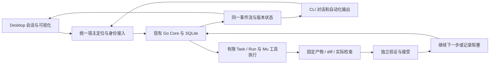

# ResearchOS 产品构造复核与分阶段方案

状态：PROPOSED_NOT_APPLIED。核查基线为 Main `3cd8e4ce`、CP578；2026-11-04。依据最新用户要求，暂停机械推进旧任务卡，先按真实产品闭环排序。本报告没有改变协议、数据库、权限、原验收门或产品代码。

## 核心判断

产品定位应是“能理解项目、执行工作、展示变化并可靠接续的智能工作台”。CLI 和 Desktop 是同一能力的两个入口；研究、评测与自我改进服务于当前项目问题。先把一个真实任务完整做成，再增加自动化范围。

现有仓库有实质内核，值得接续。最先要解决的是入口分叉、有限回合到持续目标的差距，以及实际交付的验证和接受，不宜重写 Go 内核或继续仅增加页面、施工记录与框架。

## 已实现与已证明的边界

| 能力 | 源码事实 | 当前实证边界 |
|---|---|---|
| 智能工作台 | 生产 React renderer 已有对话、输入、文件/diff、权限、事件轨迹，七文件改进已整合 | 54 项开发界面检查、12 项独立源码测试、开发包构建及独立 dry-run；界面数据是标明的夹具，不能声称真实模型闭环 |
| 单一业务内核 | CLI/Desktop 均走 `/v2/command`，同一 Go ClientService/SQLite；已有 writer epoch、CAS、数据根独占锁 | 同一数据根有防双核心代码；当前版本的真实跨端接续尚未完成验证 |
| 真实 Agent worker | Mu/Pi SDK 的 `createAgentSession`、`session.prompt` 与受控 read/write/edit/run_check 已实现 | SDK/协议代码与有限能力验证不等于真实业务任务被独立接受 |
| 目标/规划 | 普通消息和显式 goal.start 共用有限目标构造器；另有意图规划链 | 有限路径创建一个 mu_turn，900 秒、max_attempts=1；普通规划节点目前限于 json_report 与固定 JSON 比较，另有专用监测循环分支，尚非通用编码 DAG |
| 恢复与验证 | journal/effect/checkpoint、取消/租约、有限回合验证和接受事务已有实现 | verifyMuTurn 明确只证明回合执行；普通 LIVE 交付 Goal 的最终接受目前返回 503，仅绑定的规划 Goal 有 LIVE 例外 |

关键源码依据：

- [有限目标构造](D:/作品集/ResearchOS/research-os/internal/domain/client_protocol_goal.go:75)、[普通消息使用该路径](D:/作品集/ResearchOS/research-os/internal/domain/client_protocol_sessions.go:374)。
- [规划动作限制](D:/作品集/ResearchOS/research-os/internal/domain/planning_brief.go:322)、[实际工具边界](D:/作品集/ResearchOS/research-os/internal/host/runtime_tools_windows.go:60)、[固定检查限制](D:/作品集/ResearchOS/research-os/internal/host/runtime_check_windows.go:124)。
- [有限回合验证声明](D:/作品集/ResearchOS/research-os/internal/domain/runtime_model_verification.go:397)、[普通 LIVE Goal 接受硬门](D:/作品集/ResearchOS/research-os/internal/domain/acceptance_goal.go:77)。
- [CLI 默认发现路径](D:/作品集/ResearchOS/research-os/apps/cli/main.go:20)、[Desktop 默认发现路径](D:/作品集/ResearchOS/research-os/apps/desktop/main/main.js:36)。CLI 相对 cwd，Desktop 相对 REPO；CLI 异目录首先会发现失败，不会自行创建第二个数据库。不同 Core/bundle 的不同默认数据根才可能形成数据岛。发行 shim 未补齐这一默认差异。
- [已有宿主管理拒绝](D:/作品集/ResearchOS/research-os/apps/desktop/main/lib/desktop-management.js:426)：已有活 Core 被视为 EXTERNAL_HOST_PRESENT，而普通 health/v2 仍可能连接，形成“业务已连、管理不可用”的状态。
- [run 的遗留分支](D:/作品集/ResearchOS/research-os/apps/cli/cli_run_contract.go:40)、[task 的拒写实现](D:/作品集/ResearchOS/research-os/apps/cli/coding_task.go:53)：公开入口仍混有旧施工级语义。

## 保留、修改、暂缓

| 处理 | 具体决定 | 原因与影响 |
|---|---|---|
| 保留 | Go/SQLite 业务权威、Mu worker、统一协议/事件、服务端租约/CAS、受控工具、证据版本与恢复 | 已有大量实现；重写会扩大迁移面，无法自动解决真实闭环缺口 |
| 修改 | 与 cwd 无关的默认宿主定位；区分 OWNED 与 ATTACHED；统一公开 CLI 行为 | 收口两个入口。保留管理权限校验，不能简单删除 EXTERNAL_HOST_PRESENT 保护或信任任意 localhost |
| 修改 | 会话、有限执行回合、持续目标分别表达；持续目标拥有稳定身份与下一步 | 普通对话可轻量运行；明确目标才跨轮编排。复用现有实体与协调器，不新增第二调度器 |
| 修改 | 首屏以目标、当前动作、diff/检查、阻塞和下一步为中心 | 右侧当前固定“发现/核验/实验…”适合研究周期，不能替代编码迭代进度；旧研究阶段保留在研究视图 |
| 修改 | 将真实交付检查接入既有 Task/Goal 接受事务 | 不能只删除 503 或把模型结束改成 PASS；必须先补当前版本、实际检查、独立主体和产物绑定 |
| 暂缓 | 第二 Agent 框架、第二业务状态机、额外图记忆、多套桌面、复杂多宿主 | 当前缺口在已有能力接线与交付验证；先不扩大基础设施 |
| 后置 | 全自动替换运行中的 ResearchOS、系统晋升、手机远控与隔夜发布 | 保留现有恢复/回滚与权限门。项目内迭代可先形成可审查候选，系统自升级继续独立受控 |

## 建议的统一运行关系

这是目标构造图。上述通用“交付接受→下一轮”尚未端到端验证，不能因图存在就宣称实现。

## 分阶段施工

1. **统一入口，完成一次真实工作。** 冻结 `CLI-HOST-DISCOVERY-001`：从另一个项目目录运行 CLI，应连接与 Desktop 相同的 Host ID/数据根，无须复制短期 token。保持开发隔离 override。清理公开 run/task 的双重语义，修复目录选择无法打开却被统称取消的问题。随后用现有 Mu 做一个当前确实存在的 Go 问题，实际读改文件、运行冻结检查并展示 diff。验收看实际文件、退出码、身份与证据，不用施工模型改文件冒充产品 Agent 成果。

2. **补齐可恢复的项目迭代闭环。** 在原协调器内增加明确的“计划下一步→执行→检查→独立审查→继续/阻塞”能力，先一个 worker，依赖独立时再开第二个。补 typed coding action/check 编译与普通 LIVE Goal 接受；冻结检查由独立流程持有。阶段结束必须证明失败不会误完结、取消不自动重启、未知副作用先对账、暂停重开和 CLI→Desktop→CLI 保留同一目标/会话及单 writer。worker 的单轮上限保留，跨轮由 Go 持久调度，不把 Mu 改成第二主控。

3. **把工作台连到真实迭代。** 左侧突出项目和最近会话，研究/知识/团队为次级能力；中央对话与输入；右侧展示当前目标、步骤、工具、检查、成果和下一步。使用既有 Task/Run/Artifact/AcceptanceReceipt/事件投影。为自身前端增加受控 npm/Vite 检查 adapter，不能用通用 shell 绕开现有工具边界。通过真实数据验证，不再以夹具截图证明产品完成。

4. **按问题启用研究与自我改进。** 当前工作有能力缺口才触发来源查证、候选实验和复用判断；Jev/技能评估保留用途资格和建议边界。先生成项目候选与可审查补丁，再做独立比较。只有恢复、稳定监督与回滚资格有效时才晋升系统本体；无改善可保留稳定版。最后逐步闭合安装、跨端、手机与真实隔夜等适用发布门。

每阶段交付一个可亲自使用的变化及真实证据；旧规格作为能力/风险清单，开发顺序按最短产品路径调整。所有范围、协议或发布标准变化先写差异决策，不反改只读包，不把未实现项目改成已通过。

## 重大改动的依据、风险和迁移方式

- **宿主定位统一**：必要性是当前 cwd/REPO 默认不一致。风险是误接或复制已有数据库、多个旧数据根同名。先盘点并选择原有合法根，保留每个身份和备份；不自动合并数据库。新增用户级定位记录，验证 OS 主体、Host 身份与进程；保留现有数据根锁。
- **持续目标与 LIVE 接受**：必要性是单轮 Goal 和普通 LIVE 硬门。风险是旧会话与接受记录语义改变、候选自批。先对新目标提供明确能力版本，保留旧记录及回合语义；独立检查成立后才开放接受与下一步，不批量回填旧 PASS。
- **CLI 命令收口**：必要性是同名 run/task 存在旧分支。风险是旧脚本依赖。先给出显式兼容提示和迁移映射，将施工工具保留在开发入口；公开命令统一发同一协议，未支持操作继续非零退出。

## W05-99 与旧现场对账

W05-99 为 IN_PROGRESS，六项依赖卡已登记 ACCEPTED，但这不等于父任务/正式用例接受。H08/P01/U02 缺 selector；G02/A04 固定转发 fixture 后被旧 parser 拒绝；旧 emitter 无法覆盖 A04-01..06 的新增断言。C11/C15 最终负责人为 W12。应修真实 handler/绑定，不能继续碰撞旧命令或将问题全归为资源不足。

CP575 的“C then A2/D 尚未开始”交接已过时：实际 C→D 于 10/28 执行完毕，scope 的两次调用耗尽，控制器退出 0，但两次均无可用目录窗口且未发送取消。以实际 RESULT/CONTROLLER-TERMINAL 为准，不重跑旧 scope。Installer P1b 仍只找到 9/11 个未跟踪源码，缺测试/文档，指定媒体构建和回执不存在，不能称正在构建或已完成。

本轮没有产品运行、模型调用或架构代码修改；已完成的 UI/开发包保留。正式有效接受仍为 0/42，原 22 父任务尚未全部有效接受；最新方向也不构成对旧失败计数、权限或真实证据的豁免。
